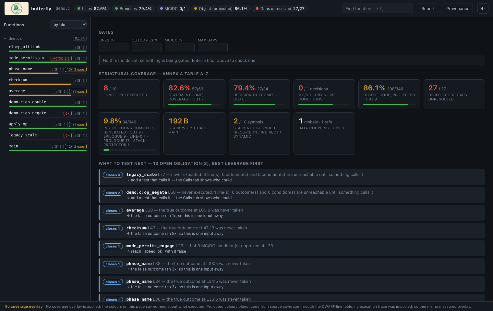

# butterfly

[](https://github.com/Aravindargutus/butterfly/actions/workflows/ci.yml)

*Licensed under MIT OR Apache-2.0. See [NOTICE](NOTICE) for attribution.*

A read-only web browser over compiled evidence for DO-178C structural coverage
and object-code analysis. Not an editor. Point it at what your compiler,
coverage tools and simulator already produced; it shows, per function, what a
reviewer needs to see for Annex A tables A-5 and A-7.

```
butterfly ingest <build-dir>            # artifacts -> evidence.json
butterfly serve  evidence.json          # http://127.0.0.1:8787/
```

## Install

### 1. Prerequisites

Install Git and rustup. For the C demo below, install Clang 18 or later with its matching LLVM tools and profiling runtime. On macOS, install the Xcode Command Line Tools with `xcode-select --install`. With Homebrew, install `llvm@19` and run `export PATH="$(brew --prefix llvm@19)/bin:$PATH"`. On Ubuntu 24.04, install `clang-18 llvm-18 libclang-rt-18-dev` and run `export CC=clang-18 LLVM_BIN=/usr/lib/llvm-18/bin`.

| | why | check |
|---|---|---|
| **Rust via [rustup](https://rustup.rs/)** | to build butterfly | `rustc --version` |
| **`llvm-tools`** | `llvm-objdump` reads the object code; `llvm-cov`/`llvm-profdata` produce the coverage | `rustup component add llvm-tools` |
| **your project's compiler** | clang/clang++ for C/C++, rustc for Rust | `clang --version` |

butterfly does not need a system LLVM install: `llvm-tools` ships the matching
`llvm-objdump`, `llvm-cov` and `llvm-profdata` with the Rust toolchain.

> **The LLVM version has to match the compiler that wrote the profile.** A
> raw profile carries a format version that `llvm-profdata` must match
> exactly — a mismatch gives `raw profile version mismatch … no profile can be
> merged` even though the file is there.
>
> The example scripts work this out for themselves: each one names the
> compiler it builds with (`CC`, or `CXX` for the C++ examples), uses that
> same variable to compile, and asks *it* where its own `llvm-profdata` is.
> The lookup and the build therefore cannot disagree. Choosing a different
> compiler chooses its tools with it — `CC=/usr/lib/llvm-18/bin/clang
> ./examples/c/build.sh` needs nothing further.
>
> If the compiler cannot say where its tools are, the build **stops and says
> so** rather than reaching for some other LLVM: an unrelated reader paired
> with a writer is a coin flip that comes up `no profile can be merged` the
> moment the two versions drift. Set `LLVM_BIN` to the directory holding the
> matching `llvm-profdata` to say explicitly which to use — that overrides
> everything, and CI's Linux job does exactly that for clang 18.
>
> `butterfly build` works the same way for the same reason.

### 2. Build and install

```sh
git clone https://github.com/Aravindargutus/butterfly.git
cd butterfly
cargo install --locked --path crates/cli
```

That puts a single self-contained `butterfly` binary in `~/.cargo/bin` — the
web UI is compiled into it, so there is nothing else to copy or serve. Add
`~/.cargo/bin` to your `PATH` if it is not already there.

`rust-toolchain.toml` pins the build to Rust 1.97.1 with `llvm-tools`; rustup
downloads it on first build. To work in the repo without installing, replace
`butterfly` with `cargo run --` in any command below.

### 3. Check it works

```sh
butterfly --version
./examples/c/build.sh
butterfly ingest examples/c/build --source-root examples/c -o examples/c/build/evidence.json
butterfly serve examples/c/build/evidence.json      # http://127.0.0.1:8787/
```

Open **http://127.0.0.1:8787/** in your browser while the server runs. Select a function in the sidebar to inspect its source and coverage. Press Ctrl+C in the terminal to stop the server.

[](docs/quickstart.png)

*The C demo after ingest on macOS with LLVM 19. Select the image to read the coverage results at full size.*

If `ingest` reports `cannot find llvm-objdump`, either run
`rustup component add llvm-tools` or point `BUTTERFLY_LLVM_BIN` at a directory
holding the LLVM binaries. butterfly searches, in order: `--llvm-bin`,
`BUTTERFLY_LLVM_BIN`, every installed rustup toolchain, then `PATH`.

`butterfly build` chooses differently, because it has a profile to merge and
the format version has to match the compiler that wrote it. `[coverage]
llvm_bin` in the build config wins outright. For a `rustc` project the
coverage compiler's own sysroot comes next — it is definitional, and an
`LLVM_BIN` exported for a clang must not override it — then
`BUTTERFLY_LLVM_BIN` or `LLVM_BIN`, then whatever is installed. For a `clang`
project `BUTTERFLY_LLVM_BIN` or `LLVM_BIN` comes first, then what
`clang -print-prog-name=llvm-profdata` reports, then whatever is installed.

### Platform notes

* **Entry point** — recorded as a virtual address on every format. A Mach-O
  header holds `LC_MAIN.entryoff`, a file offset, so it is mapped through the
  executable segment that contains it; ELF and PE already carry an address.
  That is what lets the entry be matched to its symbol and exempted from
  dead-code candidacy.
* **macOS** — debug info stays in the `.o` files behind a debug map. A
  single-step compile-and-link runs `dsymutil` for you; **a link of separate
  objects does not**, and without the `.dSYM` the binary has no line table and
  every instruction lands in "no source line". Run `dsymutil <binary>` after
  linking. See [`examples/c-lib`](examples/c-lib#the-two-builds-and-one-macos-trap).
* **Linux** — DWARF is in the binary; no extra step.
* **Cross / bare-metal targets** — nothing needs to run on your machine.
  butterfly reads the coverage export, the binary and an optional execution
  trace, so a target image analysed from a QEMU or hardware trace works the
  same way.

### Uninstall

```sh
cargo uninstall butterfly
```

## Commands

`butterfly <command> --help` for the full option list.

| command | what it does |
|---|---|
| `ingest <dir>` | read a build directory (or explicit `--coverage`/`--object`) and write `evidence.json`. **`-o` defaults to `./evidence.json`, not into the build directory.** |
| `serve <evidence…>` | the browser UI on `127.0.0.1:8787`. Several files = variants of the same sources, comparable in the UI. |
| `ozone <report.txt>` | read a SEGGER Ozone Code Profile Report and print the covered and total counts by module and function as JSON. |
| `summary <evidence>` | one-screen textual roll-up, for CI logs |
| `report <evidence>` | a self-contained HTML Software Verification Results report |
| `baseline <evidence>` | freeze the analysis baseline (§4.4.2.c); an ingest compares against it and flags stale analyses when given it with `--baseline`, or when it finds a `butterfly-baseline.json` in the build directory it reads (#238, fixed by #241). With neither, nothing is compared |
| `build <config.toml>` | drive the compiler for several optimisation levels and compare them. **Exploratory — never certification evidence.** |
| `changes <evidence>` | change impact (§12.1.1): the commits and tickets that touched each function, read from git history and written back into the evidence, with a cache next to it so re-runs only walk what changed |
| `impact <evidence>` | the re-verification obligations those changes create, from the evidence alone (no git); `--fail-on blocker\|major\|any` exits 3 for CI; `--json` for machines; `--write` stores them in the evidence |
| `tags <evidence>` | **optional.** write a source definition index (`<evidence-stem>.tags.json`, e.g. `evidence.tags.json`) beside the evidence for "go to definition" in the viewer. Needs [Universal Ctags](https://ctags.io); its absence changes nothing else. **Not certification evidence** — a navigation aid, kept out of the evidence deliberately. |
| `doctor <dir>` | check a build directory *before* ingesting it: is everything butterfly needs here, and if not, what should the build produce instead — with the fix named beside it, per build system where the build system is the cause and per toolchain where it is not. Exit 3 when something would make the evidence **wrong** rather than merely thinner. |
| `claims <evidence>` | compare the requirements document's own traceability claims with what the build measured. Exit 3 when they disagree, `--json` for machines. |
| `requirements <input…>` | **optional.** read low-level requirement text from YAML, CSV or Markdown into `requirements.json` beside the evidence, so a `@satisfies` tag can show what it refers to. A directory is walked for `llr.yaml`, `llr.csv` and `llr.md` (and `.yml`/`.markdown`). Kept out of the evidence deliberately: prose is owned by the requirements tool and baselined on its own schedule. |

`ingest <dir>` discovers what it needs: the llvm-cov export, the
non-instrumented binary, `build-info.txt`, `*.su` stack files, a `*trace*.log`,
`butterfly.toml` and `butterfly-baseline.json`. Instrumented binaries (those
carrying `__llvm_covmap`) are skipped, so pointing it at a directory holding
both builds does the right thing.

### SEGGER Ozone / J-Trace coverage

After capturing a run in Ozone, open **Code Profile Export**, select the functions
to include, and choose **Report** for the output format. Butterfly reads the
English text report's **Code Coverage Summary** table. To inspect the capture
on its own or attach it to an existing compiler-coverage workflow:

```sh
butterfly ozone ozone-report.txt
butterfly ingest ./build --ozone-report ozone-report.txt -o evidence.json
butterfly summary evidence.json
```

Try the [worked Ozone example](examples/ozone/README.md) to reproduce the output locally.

The JSON preserves module names, function names, and Ozone's covered/total
source-line and instruction counts. The total describes the selected export
scope. Attached reports appear under `ozoneReport`, with the input hash in
provenance. Ozone applies its own coverage rules to conditional instructions.
These aggregates carry no per-address execution counts, branch outcomes or
MC/DC vectors. `butterfly ozone`, `ingest` and `summary` show the report;
`butterfly report` and `butterfly serve` do not render it yet. The first
importer supports the text report. Ozone CSV exports
and raw J-Trace captures would need separate readers.
[SEGGER Ozone User Guide, Code Profile Export Dialog](https://www.segger.com/downloads/jlink/UM08025_Ozone.pdf)

### Go to definition (optional)

`butterfly tags <evidence.json>` runs [Universal Ctags](https://ctags.io) over
the sources the evidence covers, plus the headers they include, and writes a
`<evidence-stem>.tags.json` sidecar beside it (`evidence.tags.json` for
`evidence.json`, which is where the viewer looks for it) so the viewer can
jump from an identifier to its definition. It is deliberately **separate from
the evidence**: where a macro is defined is a navigation convenience, not part
of the certification record, so it rides beside it and its absence changes
nothing.

It covers what the object-code model has no notion of — types, macros,
typedefs, struct members — and links a definition back to its analysed
function when there is one, so the viewer can send that to the control-flow
view while a header-only inline function or a bare type goes to its source
line. A definition in a header the evidence never compiled is marked as such,
rather than pretended to be one of the files already on the page.

`serve` picks the sidecar up automatically when it sits beside the evidence
and was built against it — a stale one is ignored with a note rather than
pointing at lines that have moved. Identifiers in the source view then become
jump targets, and clicking one goes to:

* the **function view** when the definition is an analysed function, because
  that is where its control-flow graph is;
* the **file view at that line** when it is defined in a file the evidence
  carries — a type, a macro, a struct member, a static function;
* **nowhere**, when it is defined in a header the evidence does not carry. It
  is marked on hover and its location named in the tooltip, but it is not a
  link: there is no file view to open, and sending the reader somewhere else
  would be worse than not moving.

Nothing is underlined at rest — the source view is for reading coverage, and
marking every identifier would drown that. Hover shows what you have.

The system `ctags` on macOS is BSD ctags and will not do; install Universal
Ctags (`brew install universal-ctags`, `apt-get install universal-ctags`) or
point `--ctags-bin` / `$BUTTERFLY_CTAGS` at one.

## Where the documentation is

| | |
|---|---|
| **[`docs/butterfly.html`](docs/butterfly.html)** | **the handbook** — the whole tool in one page, with reading paths for developers, testers and managers. Open it in a browser; no server, no build step. |
| **[`docs/showcase/index.html`](docs/showcase/index.html)** | **feature showcase** — every capability with a screenshot, the commands that produced it, and the support matrix. Regenerate with `scripts/showcase.sh`; see [Showcase](#showcase). |
| this README | inputs, every view, configuration, security posture |
| [`examples/README.md`](examples/README.md) | the six worked projects and what each demonstrates |
| [`examples/c`](examples/c) | start here — single file, C, MC/DC |
| [`examples/c-lib`](examples/c-lib) | multiple files, data/control coupling, and [a library with no `main`](examples/c-lib#a-library-with-no-main) |
| `butterfly <cmd> --help` | the authoritative option list |
| the UI itself | the Overview's **gaps-by-kind** table defines every gap kind; section headings and the resolution categories cite the DO-178C paragraph they serve (`6.4.4.3.a–d`, `6.3.4.f`, `A-7 obj 8`); **Provenance** lists the exact inputs, their SHA-256, and the caveats that apply |

## What it shows

| View | Objective served | Content |
|---|---|---|
| Source pane (always one function) | A-7 obj 5/6/7 | line counts, branch outcomes, MC/DC chips, requirement tags (`@satisfies`), trace exec counts |
| **Flow** | A-7 obj 5–7, A-5 obj 4 | object-level CFG (real basic blocks), blocks coloured by *projected* or *measured* coverage, T/F edges, loops, cyclomatic complexity |
| **Calls** | A-7 obj 8, A-5 obj 2 | callers ← function → callees, edges coloured by whether the call was exercised |
| **Object** | A-7 obj 9 | every instruction with its DWARF line, projected status, trace executions, ▲ gap markers |
| **Gaps** | §6.4.4.2.b, §6.4.4.3 | findings where source coverage cannot describe the object code; projection-vs-trace disagreements; resolution annotations (a/b/c/d1/d2/analysis) |
| **MC/DC** | A-7 obj 5 | truth table per decision: executed vectors, per-condition independence pairs |
| **Stack** | A-5 obj 6 (§6.3.4.f) | own frame, worst-case bound and the deepest call chain; recursion, indirect calls, dynamic frames, undetermined frames, over-deep chains and overflowing totals flagged not bounded |
| **Data** | A-7 obj 8 (§6.4.4.2.c) | globals this function reads / writes / takes the address of, and who else touches them |
| **Variables** | §6.4.4.2.b | parameters and locals from DWARF: kind, type, declaration line, and every instruction that reads, writes or takes the address of each one, **in static instruction order — by address, and not an execution order**: a site inside a loop is listed once however often it repeats, one inside a branch whether or not it is ever reached, so the numbering says where in the object code the touches are, never which of them ran or in what sequence. Hovering marks the declaration and each line touched, numbered in that same static order. Where a variable could not be attributed — a register-resident local, a location list, a non-AArch64 image — the reason is shown rather than an empty list. The marking is optional: a **Variable marks** toggle beside the coverage overlay switches it off, remembered per browser, and the panel lists every access either way |
| **Changes** | §12.1.1 | the commits and tickets that touched this function, line by line, with added/modified and the re-verification obligations they create; a banner when the history is stale and the command that refreshes it |
| **File view** | A-7 obj 5–7, A-7 obj 8 | the whole file instead of one function: sticky function headers, coverage minimap, fold to findings / uncovered only, object-density gutter, requirement lens, per-file coupling and dead code, `∆` since baseline — see [File view](#file-view) |
| Overview | §11.14, A-5 obj 7 (§6.3.5) | totals, gaps by kind, image sections & segments, code in the image without coverage evidence, deepest stack chains, data-coupling table, provenance |

### Projected, measured, and the gap between them

Source coverage (from `llvm-cov`) is **projected** onto instructions through
the DWARF line table. Nothing counted those instructions executing, so the
tool's first job is to expose where the projection is untrustworthy — the
**gap kinds**:

| kind | meaning |
|---|---|
| `predicated-decision` | a source decision compiled to conditional-select / table / merged code with no object-level branch (or no object code at all on that line) |
| `extra-object-branch` | more conditional branches in the object code than branch regions in the source on that line |
| `line-zero` / `no-source-line` | compiler-generated instructions not attributed to any source line |
| `helper-call` | call to a symbol outside the covered source set, classified as `runtime-check` (panics, bounds/stack checks — defensive, not dead code), `arith-helper` (compiler-rt/libgcc), `memory-helper` (memcpy family), `core-lib`, `libc`, or `project-uncovered` (project code the coverage run never instantiated) |
| `indirect-branch` | jump table, tail call or function pointer; a switch's jump table is read and its targets drawn as edges ([`examples/c-switch`](examples/c-switch)) |
| `not-instrumented` | maps to a source line that carries no coverage count |
| `folded-call` | a call written in the source with no call instruction and no DWARF inlined subroutine in the object code — the compiler evaluated it away; shown in the Calls tab as a dotted "folded away" node |
| `shared-line` | block whose instructions borrow source lines that do not describe it (merged returns, common epilogues). Reached only through a never-taken branch outcome, it is projected uncovered by branch-outcome inference, with the source lines it implements shown as `≈`. Entered unconditionally from a block with exclusive covered evidence and no call, it is projected covered although its borrowed line reads 0 (#270) |

With an execution trace (`--trace`), coverage becomes **measured**: every
instruction carries its execution count (`0` for one the trace never
executed; `measured` is `null` only in evidence with no trace, where it means
"not measured"), the UI can colour by either view, and
the Gaps tab lists where projection and trace disagree (projected-covered but
never executed; executed but projected-uncovered; executed with no projection).
The two views are only comparable when the trace and the instrumented run
execute the same test campaign on the same sources.
[`examples/rust-qemu`](examples/rust-qemu) is that arrangement worked end to
end — a bare-metal AArch64 image under QEMU — with the instructions where the
two views disagree, and the limits of what a trace establishes.

Every gap is a finding for a human, never a verdict. Resolutions live in a
sidecar (`resolutions.json`), never in the evidence file.

### Stack and data coupling

* Frame sizes come from a `.stack_sizes` section (`-fstack-size-section`,
  `-Zemit-stack-sizes`), from `.su` files (`-fstack-usage`), or — with no extra
  flags — are estimated from the function prologue in the disassembly. The
  source is shown next to every number.
* Worst case = own frame + deepest chain of *direct* calls resolved from the
  object code, over every text symbol in the image (covered or not).
  Recursion, indirect calls, dynamic frames, frames of undetermined size,
  chains deeper than the analysable depth and totals that overflow are
  reported as "not bounded" with the reason; nothing is silently capped.
* Data coupling is extracted from address-forming sequences: `adrp`+`add`/`ldr`
  /`str` on AArch64 and on x86-64 both a direct RIP-relative
  operand and the far more common clang pattern of materialising the address
  with `lea` and then loading or storing through that register — tracked until
  the register is overwritten, a call clobbers it, or control flow joins. A
  read-modify-write (`incl (%rax)`, `addl $1, g(%rip)`) counts as both a read
  and a write. Debug builds often take the address and go through the stack,
  which shows as `&`.
  There is a RISC-V path (`auipc`) in the code too, but no RISC-V example has
  ever been ingested and the path has no test, so RISC-V is **not supported**
  (`arch.riscv` in the support table below); PE/COFF objects are not handled at all.

## Examples

Six worked projects. [`examples/c`](examples/c),
[`examples/cpp`](examples/cpp) and [`examples/rust`](examples/rust) build the
same small program with each toolchain; [`examples/c-lib`](examples/c-lib),
[`examples/cpp-lib`](examples/cpp-lib) and
[`examples/rust-lib`](examples/rust-lib) build the same multi-module library,
for the data- and control-coupling objectives that only appear once a program
is split across files. Start here:

```sh
./examples/c/build.sh
butterfly ingest examples/c/build --source-root examples/c -o examples/c/build/evidence.json
butterfly serve examples/c/build/evidence.json      # http://127.0.0.1:8787/
```

See [`examples/README.md`](examples/README.md) for what each one demonstrates
and how the three toolchains differ.

## Inputs

* `llvm-cov export -format=text` JSON (versions 2.x–3.x, MC/DC records included).
  `cargo llvm-cov report --json` produces the same format.
* **or** `gcov --json-format` output, for GCC-built projects — see
  [GCC coverage](#gcc-coverage-gcov) below. butterfly reads whichever the
  export says it is; there is no flag to remember.
* The **non-instrumented** executable (ELF or Mach-O) with DWARF (`-g`).
  On macOS the `.dSYM` next to the binary is picked up automatically.
* Optional `build-info.txt` with `key=value` lines (compiler, flags, git hash),
  recorded verbatim in provenance. `butterfly build` and the shipped adapters
  also name the tools that produced `coverage.json`, each by the path that ran
  and the version it gave there: `compiler_instr` / `compiler_instr_path` (the
  compiler of the instrumented build), `llvm_profdata` / `llvm_profdata_path`
  and `llvm_cov` / `llvm_cov_path` (the tools that merged and exported the
  profile), or `gcov` / `gcov_path` for a GCC build. Profile and
  coverage-mapping formats belong to one LLVM, so the pairing can be checked
  from the evidence afterwards, and a baseline sees it change (#298).
* Optional `--trace`: QEMU `-d in_asm,exec,nochain -D trace.log`, the QEMU
  `execlog` plugin output, or a plain list of executed addresses.
* Optional `--stack-usage a.su` (repeatable).

`butterfly ingest <dir>` discovers all of them (`*.su`, `*trace*.log`);
instrumented binaries (those carrying `__llvm_covmap`) are skipped.

**Source reads are bounded by `--source-root`** (the working directory when
you do not pass one). The filenames in a coverage export are input like any
other, and every source butterfly reads is embedded whole in the evidence —
which is then served, archived and mailed around. So each name is resolved,
symlinks and `..` included, and ingest fails, naming every offender, if any of
them lands outside the root. A source with more than one name (a hard link)
is refused the same way: the kernel reports only one of a file's names, so
whether every name for it is inside the root cannot be established — replace
the link with a copy. If a build legitimately covers generated or
vendored sources elsewhere, either widen `--source-root` or pass
`--allow-external-source`, which reads them and records a caveat in the
evidence saying which files came from outside.

### What is verified, and where

butterfly reads C, C++ and Rust, but the three are **not equally proven**, and
the difference matters if you are evaluating it for a certification programme.
The table below is generated from [`support/matrix.toml`](support/matrix.toml)
and states, per construct, architecture, object format and toolchain, what is
supported, on which example it was shown, and what is not. A row that says
"not built in CI" was shown on this project's machines and is not re-checked
by any hosted run.

<!-- butterfly:matrix -->
<!-- Generated from support/matrix.toml by scripts/showcase/matrix-docs.cjs. Do not edit by hand. -->

92 rows from [`support/matrix.toml`](support/matrix.toml), which a test checks textually against the examples, evidence lines and proof tests they name: **22 supported**, **61 handled with caveats**, **9 not supported**. The caveat column is the point of the table: a row says what was shown, on which example, and what was not. The [showcase](docs/showcase/index.html) renders the same rows beside what each feature looks like.

<details><summary><b>language</b> — 49 rows: 9 supported, 35 with caveats, 5 not supported</summary>

| what | state | caveat, or why it is not supported | example | proof |
|---|---|---|---|---|
| MC/DC of a multi-condition decision, from clang's -fcoverage-mcdc<br>`c.mcdc` | Supported |  | `c` | `crates/ingest/tests/e2e_demo_c.rs::demo_c_end_to_end` |
| switch statement<br>`c.switch` | Handled, with caveats | A sixteen-case switch compiled to a jump table at -O0 and -O2: the table is read from the image, each case is an edge from the indirect branch, no case block is called unreachable and no case region a predicated decision. Only clang's table shapes are read (AArch64 word, halfword and byte entries; x86-64 32-bit offsets), and the x86-64 path has been run here on Mach-O and on rust-lld-linked x86-64 Linux ELF images of this example; until #325 the ELF disassembly's single-`#` comment hid the table's address, so no ELF table was read. Any other shape leaves the branch unresolved. The indirect branch stays a gap for a reviewer to confirm the table is the switch's. A small switch like examples/c's `phase_name` compiles to compares on AArch64; on x86-64 clang lowers it to a table too, which is read the same way. | `c-switch` | `crates/ingest/tests/jump_table.rs::the_o0_switch_is_read_through_its_table` |
| Internal-linkage (static) functions, kept apart from an extern of the same name<br>`c.static-function` | Supported |  | `c-header-inline` | `crates/ingest/tests/dup_static_symbols.rs::a_static_and_an_extern_of_one_name_stay_apart` |
| A header `static inline` compiled into several translation units<br>`c.header-static-inline` | Supported |  | `c-header-inline` | `crates/ingest/tests/dup_static_symbols.rs::each_translation_units_copy_keeps_its_own_object_code` |
| Several translation units linked into one image, including two files of the same name<br>`c.multi-unit` | Handled, with caveats | Each unit is analysed apart, but where units share a file name (`src/alpha/dup.c`, `src/beta/dup.c`) llvm-cov qualifies both statics as `dup.c:tally` and keeps a coverage record for only one: the other copy is left unattributed and out of the covered totals, with an image finding naming it, rather than credited to the first unit's function. | `c-header-inline` | `crates/ingest/tests/dup_static_symbols.rs::units_with_the_same_basename_are_not_one_unit` |
| A static function the coverage export has no record for, beside a covered extern of the same name<br>`c.static-with-no-coverage-record` | Supported |  | `c-unprofiled-static` | `crates/ingest/tests/dup_unprofiled_static.rs::an_unbound_call_keeps_its_gap_though_another_unit_covers_the_name` |
| Dispatch through a table of function pointers<br>`c.function-pointer-table` | Handled, with caveats | That op_double and op_negate are held by OPS, are the candidates of apply_op's call and are not dead code is asserted on the CI-built example (crates/ingest/tests/e2e_demo_c.rs), on every host: in an x86-64 Linux PIE the table's words are `R_*_RELATIVE` relocations the file holds as zero, and until #325 G1 both functions read as dead there. How an indirect call is drawn in the call graph is proven on hand-built evidence. The same construct in examples/c-lib (`TASKS[idx](arg)` in `sched.c`) is asserted on its image by `c_lib_arch.rs`: the call is recorded as indirect and the stack chains through it are reported unbounded. Tracked in #175. | `c` | `ui/callgraph.test.cjs::a chain through a candidate edge is a hypothesis, and stays one` |
| Direct recursion<br>`c.recursion` | Handled, with caveats | CI builds the example, but the test proves the call-graph model on hand-built evidence; no test asserts what butterfly reports for the recursion in this example. Tracked in #175. | `c-callgraph` | `ui/callgraph.test.cjs::recursion terminates and is drawn as a cycle rather than a second node` |
| Mutual recursion<br>`c.mutual-recursion` | Handled, with caveats | CI builds the example, but the test proves the call-graph model on hand-built evidence; no test asserts what butterfly reports for the recursion in this example. Tracked in #175. | `c-callgraph` | `ui/callgraph.test.cjs::mutual recursion terminates` |
| A static library archive (.a) passed as the object<br>`c.static-archive` | Not supported | Refused by design, with a message saying to link the library into a test image or pass its members: an archive has no single control-flow graph. | — |  |
| An unlinked object file (.o)<br>`c.unlinked-object` | Handled, with caveats | Shown on the library's five objects from `build-lib.sh`, against the same library linked with its harness. Every object is named UNLINKED in the evidence; only the first object's symbols, stack and data coupling are analysed, global-data references stay relocations so coupling is not reported, stack chains stop at the unit boundary, and with no entry point no dead code is claimed. Linking the library with its harness is the supported route. | `c-lib` | `crates/ingest/tests/unlinked_objects.rs::unlinked_objects_under_report_coupling_stack_and_the_entry_point` |
| Dynamic stack frames: alloca and variable-length arrays<br>`c.dynamic-frame` | Handled, with caveats | A VLA and an alloca are reported not bounded, reason "dynamic frame (alloca / VLA)", and so is every caller above them; the worst case shown is the static part of the frame. The `.su` says so where there is one; without it (and `.stack_sizes` leaves such functions out) the run-time `sp` write is recognised in the function body -- until #168 that path reported the VLA bounded by its static frame. The body scan knows clang's AArch64, x86-64, Arm and RISC-V shapes and errs towards dynamic within them (a register-sized adjustment it cannot tell from a VLA reads as dynamic), but a shape within them it does not know reads as a static frame; on any other architecture the prologue is not read either, so without a `.su` the frame is unknown and the stack is not bounded. Its x86-64 shape was checked on clang's disassembly here, and runs on an ingested x86-64 image only in hosted CI. On AArch64 Darwin such a function calls the stack probe `___chkstk_darwin` through its GOT slot (`adrp`/`ldr`/`blr x16`); the slot is resolved to the symbol the image binds it to, so the probe is a direct, runtime-check helper call and not a function-pointer call -- until #271 it read as an indirect call. The same resolution covers ELF `R_*_GLOB_DAT` slots (AArch64 `adrp`/`ldr`/`blr`, x86-64 `call *foo@GOTPCREL(%rip)`), checked here on lld-linked images and in unit tests, not on an ingested ELF image in this example, and, in a position-independent ELF image, `.got` slots an `R_*_RELATIVE` relocation fills with the start of a function of the image (#325). | `c-constructs` | `crates/ingest/tests/c_constructs.rs::a_vla_and_an_alloca_are_unbounded_without_the_su` |
| goto<br>`c.goto` | Handled, with caveats | A goto is an ordinary jump in the object-code graph: a cleanup path, a backward retry and a goto into a loop body (irreducible flow) all come out with no block called unreachable, the never-taken gotos and their labels' code uncovered, and the back edge covered. The shared return block of `goto_cleanup` borrows the closing brace, which llvm-cov counts inside the zero-count `undo_a:` label; it is projected covered by inference, because the covered `return rc;` block (the only code of its line, no call) jumps to it unconditionally, and shown as `shared-line` with that reasoning. Until #270 it read uncovered. The rule proves entry only along such an edge: a shared return reached only from blocks whose own evidence is shared, or through a call, keeps the projection of its borrowed line. | `c-constructs` | `crates/ingest/tests/c_constructs.rs::goto_paths_are_edges_and_the_untaken_ones_are_uncovered` |
| Unions<br>`c.union` | Handled, with caveats | A union is one object: a global's data coupling and a local's variable accesses are attributed to the whole union, never to a member, so writing it as `float` and reading it as `uint32_t` shows as a write and a read of the same variable -- true of the storage, silent on the type pun. Local accesses are read on AArch64 only; elsewhere the variable is listed with the reason. | `c-constructs` | `crates/ingest/tests/c_constructs.rs::unions_and_bitfields_are_whole_objects` |
| Bitfields<br>`c.bitfield` | Handled, with caveats | A bitfield access is attributed to the whole struct, not the field, and a write to one field is the read-modify-write of the word that holds it: it shows as a read and a write of the struct (as a global's data coupling, and as a local's accesses on AArch64). Which field, or which neighbouring fields the write preserved, is not reported. | `c-constructs` | `crates/ingest/tests/c_constructs.rs::unions_and_bitfields_are_whole_objects` |
| Variadic functions defined by the project<br>`c.varargs` | Handled, with caveats | A variadic function has a static, bounded frame, its `va_arg` loop is an ordinary decision, and nothing is called unreachable. `va_start` takes the `va_list`'s address, so what `va_arg` reads through it is not attributed, and the variable says so. On AArch64 Darwin `va_list` is a plain pointer; on x86-64 (and AAPCS64 Linux) clang's `va_arg` branches between the register save area and the stack, and the prologue tests `%al` before saving vector registers: compiler branches with no source decision, which by butterfly's rules would be `extra-object-branch` gaps, with the stack-area path projected covered from its line when the run never took it. That shape was read from clang's x86-64 disassembly here, not from an ingested x86-64 image. | `c-constructs` | `crates/ingest/tests/c_constructs.rs::a_variadic_function_has_a_bounded_frame_and_an_untracked_va_list` |
| Macros that expand to control flow<br>`c.control-flow-macro` | Handled, with caveats | llvm-cov locates a macro's branch regions at the #define; butterfly places them at the macro's use, where the object code is, so each use is a decision on its own line and its never-run `return` is projected uncovered. Until #168 they were dropped: the object branches read as compiler-generated and the never-run return projected covered from the use line. A multi-condition (MC/DC) decision inside a macro is placed at the use as well, its conditions in the #define's order; until #269 it was reported at the #define line as a predicated decision with no object code. The LLVM 18 export layout (Apple clang 17, clang 18) names no file for an MC/DC decision, so it is recovered from where the decision's conditions lie; when that does not settle it (two uses of one macro in a function with different MC/DC results) the decision is not shown and a caveat names it. The LLVM 19+ layout, which states the file, is covered by unit tests only: no host here exports it. Everything a macro expands to shares its use line, so which part of the expansion an instruction implements is inferred, not read. | `c-constructs` | `crates/ingest/tests/c_constructs.rs::a_decision_inside_a_macro_is_placed_at_the_macro_use` |
| setjmp / longjmp<br>`c.setjmp-longjmp` | Not supported | Not claimed anywhere and exercised by nothing. | — |  |
| Inline assembly in C<br>`c.inline-assembly` | Not supported | Not claimed anywhere, and no C or C++ example uses it. The Rust inline assembly of examples/rust-qemu (its bare-metal start-up and exit) is not claimed as support either, and no test examines how butterfly reads it. | — |  |
| Same-named functions in anonymous namespaces of different units<br>`cpp.anonymous-namespace` | Supported |  | `cpp-header-inline` | `crates/ingest/tests/dup_cpp_symbols.rs::anonymous_namespace_copies_keep_their_own_unit` |
| A header `inline` function compiled into several translation units<br>`cpp.header-inline` | Supported |  | `cpp-header-inline` | `crates/ingest/tests/dup_cpp_symbols.rs::the_header_inline_is_attributed` |
| Itanium name demangling, including llvm-cov's file-qualified form<br>`cpp.demangling` | Supported |  | `cpp-header-inline` | `crates/ingest/tests/dup_cpp_symbols.rs::anonymous_namespace_copies_keep_their_own_unit` |
| A function template instantiated at two types<br>`cpp.template` | Handled, with caveats | Each instantiation is a function of its own, projected from its own coverage record; the file's source view is the sum over them, so a line reads covered there if either type ran it. This example's two instantiations take the same path, so it does not show them differing; examples/rust-constructs does (see rust.generics). Tracked in #158. | `cpp` | `crates/ingest/tests/e2e_cpp_constructs.rs::cpp_example_is_inventoried_with_the_cpp_vocabulary` |
| Virtual dispatch through a vtable<br>`cpp.virtual-dispatch` | Handled, with caveats | The call is an indirect branch: its target set is not resolved, and a stack bound through it is refused rather than guessed. The test here asserts only that the overriding apply() is inventoried as virtual; a virtual call read as an indirect branch is asserted on examples/cpp-exceptions and examples/cpp-constructs. Tracked in #158. | `cpp` | `crates/ingest/tests/e2e_cpp_constructs.rs::cpp_example_is_inventoried_with_the_cpp_vocabulary` |
| MC/DC of a multi-condition decision in C++<br>`cpp.mcdc` | Handled, with caveats | The example is built in CI, but no test asserts C++ MC/DC on it. Tracked in #158. | `cpp` |  |
| Static initialisers: the constructor function the compiler emits for globals<br>`cpp.static-initialiser` | Handled, with caveats | The example is built in CI, but no test asserts this. `_GLOBAL__sub_I_*` has no source statement behind it and is listed as a dead-code candidate, because the runtime calls it and nothing in the image does. Tracked in #158. | `cpp-lib` |  |
| A class hierarchy whose key function lives in another translation unit<br>`cpp.cross-file-vtable` | Handled, with caveats | The example is built in CI, but no test asserts the cross-file key-function behaviour. Tracked in #158. | `cpp-lib` |  |
| Exceptions: throw, catch, landing pads and unwind tables<br>`cpp.exceptions` | Handled, with caveats | A throw, a try/catch and the destructors run on unwind, built with exceptions and without. Landing pads are read from the exception table (Mach-O `__unwind_info` here; ELF `.eh_frame` on the x86-64 image hosted CI builds, where this test runs too, and on two lld-linked images in crates/ingest/tests/req_e_elf_images.rs) and drawn as exception edges, so no pad is called unreachable; an exception edge is never projected covered, because a pad's lines also run on the normal path. The calls into the C++ runtime's throw, catch, unwind and `dynamic_cast` machinery are classified as the language runtime; a landing pad's call to `__clang_call_terminate` is classified as a runtime check. The unwinder's own stack use when a throw happens is not counted, and whether each exception edge was taken is not in the evidence. | `cpp-exceptions` | `crates/ingest/tests/cpp_exceptions.rs::landing_pads_are_reached_through_the_exception_table` |
| RTTI: dynamic_cast and typeid<br>`cpp.rtti` | Handled, with caveats | A dynamic_cast, built with RTTI and without. The call to __dynamic_cast is classified as the language runtime; the typeinfo it reads is data and is not analysed. typeid is not exercised. | `cpp-exceptions` | `crates/ingest/tests/cpp_exceptions.rs::the_exception_and_rtti_runtime_is_classified` |
| Lambdas<br>`cpp.lambda` | Handled, with caveats | Every closure's operator() is matched to its object code, whether it is named $_N (in a non-inline function) or {lambda(int, int)#1} (in an inline one); the calls into them from a template, a direct call and an inline member are drawn, and the one converted to a function pointer, reached through the compiler's __invoke, is not reported as dead code. A lambda converted to a function pointer brings a conversion operator and a static __invoke that have no coverage record: each is a function of its own, projected unknown rather than from its enclosing function's lines (#273), and the call through the pointer is an indirect branch whose target is not resolved, so the stack above it is unbounded. Asserted on arm64 Mach-O and on the x86-64 ELF image hosted CI builds. | `cpp-constructs` | `crates/ingest/tests/cpp_constructs.rs::every_lambda_is_matched_to_its_object_code_and_its_callers` |
| Operator overloading<br>`cpp.operator-overloading` | Supported |  | `cpp-constructs` | `crates/ingest/tests/cpp_constructs.rs::overloaded_operators_are_functions_with_callers` |
| User-written constructors and destructors<br>`cpp.constructor-destructor` | Handled, with caveats | Every variant (C1/C2, D0/D1/D2) is attributed to its source function, and the body the coverage record names is the function's object code, so a derived constructor is shown calling its base's; a local's destructor is a call on the closing brace. The other variants are analysed too, as the function's variants: blocks, gaps and a projected status, each address once. The instrumentation counts only the body, so where the body ran, source coverage cannot say whether a variant did: its instructions are projected unknown, not covered, it is an uncounted-variant gap, and its bytes are not in the image's covered-bytes figure. Channel's deleting destructor, which never runs, is therefore reported but not shown as never run; a trace is what shows that. A variant of a body that never ran is projected uncovered. Asserted on arm64 Mach-O, where C1 and D1 are separate thunks; on the x86-64 ELF image hosted CI builds they are aliases of the body and only D0 is a variant, which every_constructor_and_destructor_variant_is_analysed_once asserts there in hosted CI. | `cpp-constructs` | `crates/ingest/tests/cpp_constructs.rs::a_constructor_is_analysed_from_the_variant_that_has_its_body` |
| new / delete<br>`cpp.new-delete` | Handled, with caveats | The example's calls to the global operator new, new[] and delete[] are core-lib helper calls, the class std:: code gets; a delete through a base pointer is an extra object branch (the null check) and an indirect branch (the virtual deleting destructor). The deleting destructor's own call to operator delete is a core-lib helper call in that variant, though whether a given deleting destructor ran is not established by source coverage (see cpp.constructor-destructor). A class-specific operator new is classified as project code by a unit test of the classifier (synthetic.rs::helper_classification), not by this example. | `cpp-constructs` | `crates/ingest/tests/cpp_constructs.rs::new_and_delete_are_calls_into_the_cpp_runtime` |
| The C++ standard library: containers, algorithms, smart pointers<br>`cpp.standard-library` | Not supported | Not claimed and exercised by nothing: the C++ examples include only <cstdint>, <cstdio> and <cstring>. | — |  |
| MC/DC from Rust<br>`rust.mcdc` | Not supported | rustc cannot supply it: current nightlies reject -Zcoverage-options=mcdc and stable emits no branch regions, so the example yields statement and branch coverage only. | `rust` |  |
| Statement and branch coverage of `if` and `match`<br>`rust.branch-coverage` | Handled, with caveats | Only `if` conditions have outcome coverage: rustc emits no branch region for a `match` arm, so a `match` is covered arm by arm as lines. Branch regions need a nightly rustc (see toolchain.rustc-nightly). | `rust` | `crates/ingest/tests/e2e_rust_constructs.rs::if_conditions_are_branch_regions_and_match_arms_are_lines` |
| Rust symbol demangling<br>`rust.demangling` | Supported |  | `rust` | `crates/ingest/tests/e2e_rust_constructs.rs::rust_symbols_are_demangled_and_join_across_the_two_compilers` |
| Compiler-inserted runtime checks (overflow, bounds, division) classified as such<br>`rust.runtime-check` | Handled, with caveats | The checks are classified as runtime checks, but the projection calls them covered because their line ran, though no input divides by zero; only a trace shows they did not run (see rust.panic-path-measured). They are object code with no source counterpart, to be justified, not covered. On x86-64 Linux rustc calls the panic through a GOT slot (`call *slot(%rip)`), which is read as the direct call it is; until #325 it was an indirect call there, and the checks went unclassified. | `rust` | `crates/ingest/tests/e2e_rust_constructs.rs::the_division_checks_in_average_are_classified_as_runtime_checks` |
| Closures: capturing by reference and by move, passed as FnMut and FnOnce to generic functions<br>`rust.closure` | Handled, with caveats | A closure whose body rustc maps no region in (`\|_\| count += 1` here) gets no coverage record. butterfly lists it as a function with no record, inside the function it is written in, on the line the DWARF gives: its object code is analysed but projected neither covered nor uncovered, and carries no-coverage-record gaps, while the line it is written on reads covered through the enclosing function's counts. Whether it ran is not established without a trace. The construct inventory counts closures lexically. | `rust-constructs` | `crates/ingest/tests/rust_constructs.rs::closures_are_functions_of_their_own_called_by_their_own_generic_copy` |
| Stack frames recovered from the prologue, since rustc writes no .su file<br>`rust.prologue-frame` | Handled, with caveats | A prologue-derived frame is an estimate, labelled as one, not a size the compiler reported. The test asserts the label, not the byte counts, which are the host code generator's; prologue reading itself is unit-tested on hand-written instruction lists. | `rust-lib` | `crates/ingest/tests/e2e_rust_constructs.rs::every_rust_frame_is_a_prologue_estimate_labelled_as_one` |
| Atomic statics as the globals of data coupling<br>`rust.atomic-global` | Handled, with caveats | At -Copt-level=0 every access is a call into core::sync::atomic, so a function is recorded as taking the static's address, not as reading or writing it. Which functions those are is asserted on macOS/AArch64 and x86-64 Linux only; elsewhere the test asserts only that the statics are globals of the image. | `rust-lib` | `crates/ingest/tests/e2e_rust_constructs.rs::the_atomic_statics_are_globals_of_the_data_coupling` |
| Dispatch through a table of fn pointers<br>`rust.fn-pointer-table` | Handled, with caveats | The call is an indirect-branch gap whose candidates are the functions its caller takes the address of and those held in any data it reads, each table read as far as its symbol extends; here the caller takes no address, so they are the table's. An ELF symbol has a size, so on x86-64 Linux they are exactly the three; a Mach-O symbol has none, so on macOS the table is read up to the next data symbol and the candidates take in the std vtables after it. That the table's entries are among them, and are held by the table, is asserted on macOS/AArch64 and x86-64 Linux only. In a position-independent ELF image the table's words are `R_*_RELATIVE` relocations the file holds as zero; they are read through the relocation, and until #325 G1 they were not, so on Linux the call had no candidates. | `rust-lib` | `crates/ingest/tests/e2e_rust_constructs.rs::the_task_table_dispatch_is_an_indirect_call` |
| A `no_std`, `no_main` bare-metal image (aarch64-unknown-none-softfloat), analysed beside a host build of the same crate<br>`rust.no-std-bare-metal` | Handled, with caveats | Verified locally, not in hosted CI, and only on a host that has QEMU (see feature.measured-coverage). A bare-metal image has no filesystem to write a profile to, so the source coverage comes from an instrumented host build and is matched to the target image by demangled name: sound only while both compile the same source the same way, and anything behind cfg(target_os = "none") has no projection at all. Tracked in #164. | `rust-qemu` | `crates/ingest/tests/e2e_rust_qemu.rs::a_qemu_trace_yields_measured_instruction_and_outcome_coverage` |
| The Level A route: object-level branch outcomes measured from a trace, where rustc supplies no MC/DC<br>`rust.level-a-route` | Handled, with caveats | Verified locally, not in hosted CI, and only on a host that has QEMU (see feature.measured-coverage). Measured object branch outcomes are not MC/DC: whether they satisfy objective 5 for a given compiler and options is the argument CAST-17 describes, and it is the applicant's to make. The trace is from QEMU, an emulator and not the target, on one CPU; butterfly is not a qualified tool. Tracked in #164. | `rust-qemu` | `crates/ingest/tests/e2e_rust_qemu.rs::the_trace_confirms_what_was_never_run` |
| Bounds- and overflow-check panic paths: projected covered by their line, measured never executed<br>`rust.panic-path-measured` | Handled, with caveats | Verified locally, not in hosted CI, and only on a host that has QEMU (see feature.measured-coverage). At -Copt-level=0 only. The trace shows the panic paths did not run; it does not show whether they need to be, so they remain object code with no source counterpart for a reviewer to account for (see rust.runtime-check for their classification). Tracked in #164. | `rust-qemu` | `crates/ingest/tests/e2e_rust_qemu.rs::the_trace_contradicts_the_projection_on_the_panic_paths` |
| An indirect call through a fn-pointer table, resolved to the targets a trace actually reached<br>`rust.indirect-call-measured` | Handled, with caveats | Verified locally, not in hosted CI, and only on a host that has QEMU (see feature.measured-coverage). The measured targets are those of one traced campaign, not the set the call can reach: a candidate the trace never reached (cmd_hold here) stays address-taken, not proven unreachable. Tracked in #164. | `rust-qemu` | `crates/ingest/tests/e2e_rust_qemu.rs::the_trace_confirms_what_was_never_run` |
| Generic functions and their monomorphised copies<br>`rust.generics` | Handled, with caveats | Each copy (`limit::<i32>`, `limit::<u64>`) is a function of its own, with its own symbol, branch record, line figures and object-code projection. The file's source view is the sum over the copies, as llvm-cov makes it: a line reads covered there if any copy ran it. Copies that share one name (the same crate built twice) are merged into one function instead. | `rust-constructs` | `crates/ingest/tests/rust_constructs.rs::each_monomorphised_copy_is_projected_from_its_own_record` |
| Trait objects and dyn dispatch<br>`rust.dyn-dispatch` | Handled, with caveats | The call through the vtable is an indirect-branch gap with no static candidates: the vtable arrives as an argument, so the target set is not resolved (as for cpp.virtual-dispatch). The impls it reaches have no direct caller and are not reported dead, because their vtables hold their addresses; that, and that the call has no static candidates, is asserted on macOS/AArch64 and x86-64 Linux only. On Linux a vtable's words are `R_*_RELATIVE` relocations the file holds as zero; until #325 G1 they were not read, and every such impl was a dead-code candidate there. An impl whose type is never built (Bypass here) has no vtable, and rustc emits no code for it. | `rust-constructs` | `crates/ingest/tests/rust_constructs.rs::a_dyn_call_is_an_indirect_branch_and_the_impls_behind_it_are_not_dead` |
| macro_rules! expansions that contain decisions<br>`rust.macro-rules` | Handled, with caveats | rustc emits no branch region for a condition inside a macro expansion, so the decision's outcomes are not in the source coverage at all. The image's line table puts the expanded code on the macro's definition, not on each use, so every use lands on that one line. That line has no count: its object code is projected neither covered nor uncovered and carries not-instrumented and extra-object-branch gaps, while the using lines read covered. Only a trace measures the outcomes (see rust.level-a-route). | `rust-constructs` | `crates/ingest/tests/rust_constructs.rs::a_macro_expanded_decision_lands_on_the_definition_with_no_count` |

</details>

<details><summary><b>toolchain</b> — 4 rows: 1 supported, 3 with caveats, 0 not supported</summary>

| what | state | caveat, or why it is not supported | example | proof |
|---|---|---|---|---|
| clang with llvm-cov source-based coverage<br>`toolchain.clang` | Supported |  | `c` | `crates/ingest/tests/e2e_demo_c.rs::demo_c_end_to_end` |
| GCC with gcov's JSON export<br>`toolchain.gcc-gcov` | Handled, with caveats | butterfly reads no MC/DC from gcov: condition coverage from `-fcondition-coverage` is noted in a caveat, not read as MC/DC, and gcov does not say which outcome of a branch is the true one. The reader is proven on hand-written exports (crates/ingest/tests/gcov.rs); the only tests that read the built example are the doctor's, which are compiled on Linux alone, and ci-local builds the example on Linux alone. | `c-gcc` | `crates/cli/tests/doctor.rs::a_gcc_instrumented_binary_is_recognised_and_not_analysed` |
| rustc nightly with -Cinstrument-coverage -Zcoverage-options=condition<br>`toolchain.rustc-nightly` | Handled, with caveats | No MC/DC (see rust.mcdc), and the LLVM tools must be nightly's own: stable's llvm-profdata cannot merge nightly's profile. CI pins nightly-2026-08-10; another nightly may map coverage regions differently. | `rust` | `crates/ingest/tests/e2e_rust_constructs.rs::nightly_supplies_the_coverage_and_stable_builds_the_analysed_image` |
| rustc stable, for the uninstrumented target build<br>`toolchain.rustc-stable` | Handled, with caveats | Stable emits no branch regions, so it builds the image that is analysed and nightly supplies the coverage. The two are joined by demangled name, which is sound only while both compile the same source the same way. | `rust` | `crates/ingest/tests/e2e_rust_constructs.rs::nightly_supplies_the_coverage_and_stable_builds_the_analysed_image` |

</details>

<details><summary><b>architecture</b> — 6 rows: 0 supported, 4 with caveats, 2 not supported</summary>

| what | state | caveat, or why it is not supported | example | proof |
|---|---|---|---|---|
| AArch64<br>`arch.aarch64` | Handled, with caveats | The only architecture with variable attribution. Hosted CI runs on x86-64 alone since #147, so this is exercised only when the suite runs on an AArch64 host, such as ci-local on Apple silicon. | `c` | `crates/ingest/tests/vars.rs::demo_c_carries_variables_with_ordered_accesses` |
| x86-64<br>`arch.x86-64` | Handled, with caveats | The proof is compiled only on an x86-64 host and asserts the example's globals, their readers and writers, and the chain left unbounded by the call through the task table; examples/c's variables are asserted there too (crates/ingest/tests/vars.rs). It has run on an x86-64 Mach-O build under Rosetta and in hosted CI on the x86-64 ELF image it builds. Variables are listed but not attributed: each says the architecture is why. Frame sizes and totals are the compiler's, so only the shape of the chain is asserted. Tracked in #113. | `c-lib` | `crates/ingest/tests/c_lib_arch.rs::x86_64_c_lib_couples_globals_and_reports_the_unbounded_chain` |
| RISC-V<br>`arch.riscv` | Not supported | Not yet demonstrated: there are RISC-V paths for branch conditions, prologues and data references, but no example, and the data-reference scanner has no test at all. Tracked in #161. | — |  |
| Mach-O<br>`format.macho` | Handled, with caveats | Read from a real linked image only on a macOS host; hosted CI is Linux since #147. | `c` | `crates/ingest/tests/macho_entry.rs::a_macho_entry_lands_on_the_entry_symbol` |
| ELF<br>`format.elf` | Handled, with caveats | Every example CI builds on Linux is an ELF image and hosted CI runs the example suites on it, but most of their assertions are written to hold on either format; few test an ELF-only path on an example: the C runtime's startup stubs may stay unattributed (dup_cpp_symbols.rs), a constructor's C1 and D1 are aliases of its body, so only D0 is a variant (cpp_constructs.rs), and a table is read to its symbol's size, so the fn-pointer table's candidates are exactly its three (e2e_rust_constructs.rs). The `.eh_frame` LSDA index, `R_*_GLOB_DAT` GOT calls, `.rodata` jump tables, data coupling and `.stack_sizes` are each asserted on two small lld-linked ELF images built from hand-written assembly (req_e_elf_images.rs), not on an example. Tracked in #278. | `c` | `crates/ingest/tests/dup_cpp_symbols.rs::anonymous_namespace_copies_keep_their_own_unit` |
| PE / COFF<br>`format.pe-coff` | Not supported | Not handled: butterfly recognises its header and would pass it to the generic object parser, but nothing beyond that is written for it, no example builds one and no test reads one. Tracked in #161. | — |  |

</details>

<details><summary><b>feature</b> — 33 rows: 12 supported, 19 with caveats, 2 not supported</summary>

| what | state | caveat, or why it is not supported | example | proof |
|---|---|---|---|---|
| Overview dashboard<br>`feature.overview` | Handled, with caveats | The browser check asserts that the Overview renders on the example, not the figures it shows; ci-local runs it only where Playwright is installed. Tracked in #173. | `c-per-test` | `ui/browser/checks/requirements.cjs::overview-renders` |
| Flow: the object-level control-flow graph with coverage overlay<br>`feature.flow` | Handled, with caveats | The browser check asserts that the tab renders for every function, not what the graph shows; block and edge construction is proven on hand-written instruction lists. Tracked in #174. | `c-per-test` | `ui/browser/checks/requirements.cjs::every-function-tab-renders` |
| Calls: the expandable call graph<br>`feature.calls` | Handled, with caveats | CI builds the fixture made for this graph, but the graph model is proven on hand-built evidence: the tests that ingest the fixture check its counts, its gaps and that a repeated ingest gives the same answer, not the calls it draws. Tracked in #175. | `c-callgraph` | `ui/callgraph.test.cjs::a function with neighbours of its own is offered for expansion, a leaf is not` |
| Object: every instruction with its source line and projected coverage<br>`feature.object` | Supported |  Tracked in #176. | `c` | `crates/ingest/tests/e2e_demo_c.rs::every_instruction_of_average_carries_its_source_line_and_projected_status` |
| Gaps and their recorded resolutions<br>`feature.gaps` | Supported |  Tracked in #177. | `c` | `crates/cli/tests/check_gate.rs::a_recorded_justification_counts_as_resolved` |
| MC/DC: executed vectors and independence pairs per decision<br>`feature.mcdc` | Handled, with caveats | On the example the test asserts the decision's conditions and which of them have an independence pair, not the executed vectors or which vectors form each pair: an export in the LLVM 18 MC/DC record layout, which Apple clang writes, carries no vectors at all. How vectors and pairs are read is proven on hand-built evidence (crates/ingest/tests/mcdc_vectors_by_test.rs). Tracked in #178. | `c` | `crates/ingest/tests/e2e_demo_c.rs::demo_c_end_to_end` |
| Stack: frames from the compiler's .su files and the worst-case chain<br>`feature.stack` | Supported |  Tracked in #179. | `c` | `crates/cli/tests/build_stack_usage.rs::every_variant_ingests_its_stack_usage_file` |
| Data coupling: which functions read and write each global<br>`feature.data` | Handled, with caveats | On the example, crates/ingest/tests/c_lib_arch.rs asserts who reads and writes each global, but on ELF it checks only the same-file accessors of `g_state`: a reference from another translation unit is loaded through the GOT, which the data-reference scanner does not follow. Tracked in #180. | `c-lib` | `crates/ingest/tests/synthetic.rs::datarefs_aarch64_and_x86` |
| Variables: parameters and locals with every access, in static order<br>`feature.variables` | Handled, with caveats | AArch64 only; on any other architecture the panel says why it is empty. Tracked in #181, #163. | `c` | `crates/ingest/tests/vars.rs::demo_c_carries_variables_with_ordered_accesses` |
| Change impact: the commits that touched a function and what they oblige<br>`feature.changes` | Supported |  Tracked in #182. | `c` | `crates/cli/tests/changes_cli.rs::c42b_each_commit_names_the_functions_it_touched` |
| Requirement text beside the code<br>`feature.requirement-text` | Supported |  Tracked in #183. | `c-per-test` | `crates/cli/tests/serve_requirements.rs::the_statement_comes_back_and_the_analysis_only_on_request` |
| Requirements x tests, and the claims gate that checks a project's own traceability<br>`feature.requirements-tests` | Supported |  Tracked in #184. | `c-per-test` | `crates/cli/tests/claims_gate.rs::the_fixtures_wrong_test_claim_is_caught_and_exits_three` |
| Per-test attribution: which test entered which function and line<br>`feature.per-test` | Supported |  Tracked in #184. | `c-per-test` | `crates/ingest/tests/per_test.rs::a_function_lists_the_tests_that_entered_it` |
| File view: the whole file, folded to findings<br>`feature.file-view` | Handled, with caveats | How a line is painted is proven on hand-written evidence; the File view is opened on an example only by the showcase screenshot capture, and no test asserts how it paints a line there. Tracked in #185. | `c` | `ui/lines.test.cjs::a reached line whose statement never ran is not painted covered` |
| Comparing optimisation levels as switchable variants<br>`feature.compare` | Handled, with caveats | The browser check covers switching between variants, not what the Compare page says about them, and the one Rust test that reads the built variants, crates/ingest/tests/macho_entry.rs, is allowed to skip when they are absent. Tracked in #186. | `c` | `ui/browser/checks/variants.cjs::a-superseded-load-never-commits-over-a-newer-one` |
| The static HTML report<br>`feature.report` | Supported |  Tracked in #187, #156. | `c-per-test` | `crates/cli/tests/report_requirements.rs::the_report_quotes_each_requirement_and_names_its_baseline` |
| Gates: `butterfly check` thresholds and no-regression<br>`feature.gates` | Supported |  Tracked in #188. | `c` | `crates/cli/tests/check_gate.rs::a_gap_ceiling_breach_names_the_worst_functions_and_exits_three` |
| `butterfly doctor`: is this build directory fit to analyse<br>`feature.doctor` | Handled, with caveats | The refusal this command exists for -- a directory holding only the instrumented binary, which must exit 3 -- is asserted on Linux alone, against the GCC example. Tracked in #189. | `c` | `crates/cli/tests/doctor.rs::a_complete_clang_build_passes_and_names_what_it_skipped` |
| `butterfly run`: build, doctor, ingest and report in one command, then serve<br>`feature.run` | Not supported | Not claimed as support: the showcase runs it once on examples/c (V18) and prints what it reported, but no test drives an example through it; its stop conditions are tested on throwaway projects (crates/cli/tests/run_pipeline.rs). Tracked in #190. | — |  |
| CMake<br>`feature.build-systems.cmake` | Handled, with caveats | Not built in CI: scripts/verify-build-systems.sh, which scripts/ci-local.sh runs, checks this build's evidence equals examples/c-lib's own in its counts of files, functions, symbols, lines, branches and gaps (not byte for byte), and that ingest refuses the build with one stack-usage file taken away; where this build system's tool is not installed it prints a named SKIP and the run still passes. | `build-systems/cmake` | `scripts/verify-build-systems.sh` |
| GNU make<br>`feature.build-systems.make` | Handled, with caveats | Not built in CI: scripts/verify-build-systems.sh, which scripts/ci-local.sh runs, checks this build's evidence equals examples/c-lib's own in its counts of files, functions, symbols, lines, branches and gaps (not byte for byte), and that ingest refuses the build with one stack-usage file taken away; where this build system's tool is not installed it prints a named SKIP and the run still passes. | `build-systems/make` | `scripts/verify-build-systems.sh` |
| Bazel<br>`feature.build-systems.bazel` | Handled, with caveats | Not built in CI: scripts/verify-build-systems.sh, which scripts/ci-local.sh runs, checks this build's evidence equals examples/c-lib's own in its counts of files, functions, symbols, lines, branches and gaps (not byte for byte), and that ingest refuses the build with one stack-usage file taken away; where this build system's tool is not installed it prints a named SKIP and the run still passes. | `build-systems/bazel` | `scripts/verify-build-systems.sh` |
| Analysis baseline: what changed in flags, sources and object code since a recorded build<br>`feature.baseline` | Handled, with caveats | Flag and object-code changes are proven on hand-built evidence only; on the example, crates/ingest/tests/baseline_discovery_e2e.rs plants a changed source hash in a copied baseline and asserts the function is reported source-changed. CI also runs `butterfly baseline` and `butterfly changes --baseline` on the example and checks only that they exit cleanly. Tracked in #192. | `c` | `crates/ingest/tests/synthetic.rs::baseline_compare_detects_flags_and_source_changes` |
| Go to definition, from a ctags index<br>`feature.go-to-definition` | Supported |  Tracked in #193. | `c-lib` | `crates/ingest/tests/tags.rs::produce_indexes_functions_headers_and_types` |
| Provenance: every input named and hashed, with the caveats that apply<br>`feature.provenance` | Supported |  Tracked in #194. | `c` | `crates/ingest/tests/e2e_demo_c.rs::provenance_names_every_input_of_the_example_and_carries_the_projection_caveat` |
| Source revision: the git commit or SVN revision, and whether the files the build used are that revision's, judged by their hashes where the VCS allows it<br>`feature.source-revision` | Not supported | Not yet demonstrated: ingest records it for git and SVN, and it is tested on temporary repositories (git: clean, modified, submodules, SHA-256, fsmonitor; SVN: mixed revisions, switched, sparse, externals, keywords and eol-style, a locked or newer-format working copy), but no example shows a clean and a modified build. SVN files with svn:keywords, svn:eol-style or svn:special are judged by svn status, not by hash. Tracked in #304. | — |  |
| Security posture: loopback by default, tokens, read-only network listeners<br>`feature.security` | Handled, with caveats | The proof needs no fixture and opens no example: `butterfly serve` refuses a plain-HTTP network listener before any evidence is read, so the test has no fixture to skip for. The example is named for the other half -- a token demanded on API requests, exercised against examples/c in crates/cli/tests/serve_auth.rs on the evidence and variant-listing routes -- and that test skips where the example has not been built. Tracked in #195. | `c` | `crates/cli/tests/serve_exposure.rs::a_network_listener_refuses_to_start_without_insecure_http` |
| Dead-code candidates in the linked image<br>`feature.dead-code` | Supported |  Tracked in #196. | `c` | `crates/ingest/tests/e2e_demo_c.rs::demo_c_end_to_end` |
| The source-to-object review record<br>`feature.source-to-object-review` | Handled, with caveats | Saving and removing a review is proven in a real browser, which ci-local runs only where Playwright is installed. The construct inventory that guides the review picks its vocabulary from the file extension, so C++ written in a `.h` header is read with the C vocabulary. Tracked in #196, #162. | `c-per-test` | `ui/browser/checks/review.cjs::a-review-saves-reloads-and-can-be-removed` |
| Finding your way around: search, shortcuts, jumping between uncovered regions<br>`feature.navigation` | Handled, with caveats | Search is asserted on the example and the digit tab shortcuts on hand-written evidence; nothing asserts `j`/`k` or the `]`/`[` jump between uncovered regions. Tracked in #197, #157. | `c-per-test` | `ui/browser/checks/requirements.cjs::search-narrows-and-navigates` |
| Measured object coverage from an execution trace (--trace): QEMU -d in_asm,exec,nochain<br>`feature.measured-coverage` | Handled, with caveats | Verified locally, not in hosted CI, and only on a host that has the toolchain: scripts/ci-local.sh builds this example and runs its suite where qemu-system-aarch64, the aarch64-unknown-none-softfloat target and a nightly with llvm-tools are all present, and prints a named SKIP where they are not -- so a green local run on a host without them has not exercised this row. Coverage is exact but execution counts are an upper bound: QEMU logs a block on entry, and an abandoned entry that cannot be proven impossible is still counted. One single-CPU trace from an emulator; multi-CPU logs are read per CPU and proven on hand-written logs only, as are the execlog and address-list formats. The viewer's Measured overlay is tested on hand-built evidence (ui/measured.test.cjs), not on this example. Tracked in #164. | `rust-qemu` | `crates/ingest/tests/e2e_rust_qemu.rs::a_qemu_trace_yields_measured_instruction_and_outcome_coverage` |
| Quickstart: from a built example to evidence, a summary and a report<br>`feature.quickstart` | Handled, with caveats | CI runs the documented commands from ingest to report on the example as a smoke test: each must exit cleanly and the report must be non-empty, and nothing more is asserted of them. Tracked in #199. | `c` | `scripts/ci-local.sh` |
| Import SEGGER Ozone Code Profile Reports from J-Trace workflows<br>`feature.ozone-report` | Handled, with caveats | The English text report supplies aggregate source-line and instruction counts for its selected scope. CI replays a synthetic report. CSV, raw probe captures, instruction addresses, branch outcomes and MC/DC are outside this importer. `ozone`, `ingest` and `summary` show the report; `report` and `serve` do not render it yet. | `ozone` | `crates/ingest/tests/ozone_example.rs::worked_report_preserves_function_counts_and_scope` |

</details>

<!-- /butterfly:matrix -->

Two Rust limits are worth knowing before you plan around it: the compiler
emits no MC/DC records (see the Rust notes below), and `cargo llvm-cov` runs
the tests on the host while the binary you analyse is the target build.


### C / C++ with clang

```sh
clang -g -O0 -fprofile-instr-generate -fcoverage-mapping -fcoverage-mcdc demo.c -o demo-instr
LLVM_PROFILE_FILE=demo.profraw ./demo-instr
llvm-profdata merge -sparse demo.profraw -o demo.profdata
llvm-cov export -format=text -instr-profile=demo.profdata demo-instr > coverage.json
clang -g -O0 -fstack-usage demo.c -o demo          # the code you certify (use your real flags)
```

See [`examples/c`](examples/c) for a worked project, including `butterfly.toml`.

### Rust (e.g. the ARINC 653 kernel)

```sh
cargo llvm-cov --no-report --workspace
cargo llvm-cov report --json --output-path coverage.json
qemu-system-aarch64 ... -d in_asm,exec,nochain -D qemu-trace.log -kernel target/<triple>/debug/<image>
butterfly ingest --coverage coverage.json --object target/<triple>/debug/<image> \
                 --trace qemu-trace.log --source-root .
```

**Instantiations are merged.** llvm-cov emits one record per instantiation —
a generic instantiated for several types, or the same crate compiled twice in
one build graph under different `-Cmetadata` hashes. butterfly merges records
that share a name, file and line range, summing counts exactly as llvm-cov
already does for the file's line totals, and reports how many were merged.

**Coverage build ≠ target image.** `cargo llvm-cov` runs the tests on the
host; the binary you analyse is the target build. A function exercised by the
host tests may simply not be linked into the target image (test-only code, an
API layer the image does not use, a generic instantiated only for the tests).
Those functions show *Not present in the analysed image* with the reason, and
`butterfly` distinguishes them from functions that were inlined or folded away.

Branch and condition regions need a nightly `-Zcoverage-options=branch` /
`condition`. **Current nightlies do not emit MC/DC records**
(`-Zcoverage-options=mcdc` was removed); stable emits line/region coverage
only. Host and target builds carry different symbol hashes; functions are
matched by demangled name.

See [`examples/rust`](examples/rust), which also covers the nightly/stable `llvm-profdata` mismatch.

## Gating a build (`butterfly check`)

```sh
butterfly check evidence.json \
    --min-lines 90 --min-outcomes 85 --min-mcdc 100 \
    --max-unresolved-gaps 0 \
    --no-regression evidence-last-release.json
```

A passing run exits 0, and its plain output writes nothing to stdout; with
`--json` it prints its result object there on a pass as well —
`{"passed": true, "breaches": []}` — so a script always has a document to
read. It is not quite silent:
`--max-unresolved-gaps` and `--min-mcdc` are judged against the resolutions
sidecar, so when none is discovered a passing run prints one line on stderr —

```
note     : no resolutions sidecar found; the report records no reviews or justifications
```

— because a gate that passed having read no reviews must not look like one
that read some. `--no-resolutions` says you meant it: nothing about sidecars
is then printed, for the evidence or for the `--no-regression` prior, and a
passing run that gates something really is silent. On any breach it prints
one line per breach on stderr and exits 3, the same convention `impact
--fail-on` uses. `--json` emits the breaches in that document on stdout
instead, with `"passed": false`.

With no threshold at all — no floor, no `--max-unresolved-gaps` and no
`--no-regression` — there is nothing to judge, and a pass would read like a
gate that held. So `check` says so, in one line on stderr, whatever else it
prints:

```
note     : no thresholds given; nothing is gated
```

The exit status is still 0 and stdout is unchanged. The viewer's Gates panel
says the same thing in the same words (*nothing is being gated*).

Three things the flags are careful about. `--min-lines` is **line coverage**
— a proxy for statement coverage, not proof of it, which is why the flag is
not called `--min-statement`. A floor of `100` is compared as a count, so
rounding can neither grant nor deny the last item. And a floor over records
the evidence does not carry — `--min-mcdc` against a build without
`-fcoverage-mcdc` — is a **breach**, not a vacuous pass: a gate that passes
because instrumentation was silently absent is the worst outcome a gate can
have.

`--no-regression` compares against a prior **evidence** file (nothing may be
worse: line and outcome percentages, MC/DC, the unresolved-gap count, and any
individual function whose covered lines fell while its shape was unchanged).
It is deliberately not `butterfly-baseline.json` — the baseline fingerprints
the compiler and object code and carries no coverage numbers to regress
against. Keep an evidence file from the last good build under CM and hand it
here. Justified gaps and conditions count as resolved, so the gate tightens
as reviews are recorded, not only as tests are added — on both sides of the
comparison. `--no-resolutions` applies to the prior too, so the two evidence
files are always judged under the same set of reviews; judging one side with
reviews and the other without reports a regression that is an artefact of the
flags rather than of the build.

## Requirements coverage (A-7 objectives 3 and 4)

```sh
butterfly ingest build --source-root . --tests build/tests --requirements requirements.txt
butterfly summary build/evidence.json     # the matrix, compactly
butterfly report  build/evidence.json -o report.html   # §2 of the report
```

For every requirement: the functions implementing it (from the `@satisfies`
tags), the tests exercising those functions (from `--tests`), and how much of
the implementation **those named tests** reached — never aggregate coverage
of the same lines, because §6.4.4 asks what the requirements-based tests
exercised and an aggregate cannot say. Without per-test data the matrix still
renders, labelled as the aggregate proxy it then is.

A tag's **scope** is respected: `@satisfies` on one line claims that line, not
the whole function it sits in, so a test that entered the function elsewhere
does not count as verifying it. A tag above the function claims the function.

The orphans are the point, in three directions: a requirement in the supplied
`--requirements` universe that no code is tagged with (absence is only
knowable from such a list); a requirement implemented but exercised by no
test; and functions carrying no requirement tag at all — the §6.4.4.3.c
question. `examples/c-per-test` demonstrates all three, one of each, by
design.

## What to test next

`summary` ends with a worklist, and the Overview page carries the same list:
every open **test** obligation, ranked by how much one new test would close.
A function nothing calls outranks a single untaken outcome, because one test
that reaches it may close everything behind it; conditions of one decision
group together; an untaken outcome whose sibling ran says "one input away".
Justified items drop out, so the list can reach zero. Unresolved gaps are
deliberately absent — they are reviewer work (a §6.4.4.3 category or a
§6.4.4.2.b analysis), not something a test input closes, and they live in the
Gaps tab and `butterfly check`.

## Requirement text (`requirements.json`)

`@satisfies LLR-LIM-002` in a comment gives butterfly an **ID**. To show what
that ID *says*, hand it the requirements:

```sh
butterfly requirements certification/requirements -o requirements.json
```

A directory is walked for `llr.yaml`, `llr.yml`, `llr.csv`, `llr.md` and
`llr.markdown`; a file is taken as one document, read in the format its
extension names. The result rides beside the evidence like the tags index —
optional, and its absence only means a tag shows its ID alone.

**It is not part of the evidence, deliberately.** A requirement's prose
belongs to the requirements tool, is baselined on its own schedule, and
changes for reasons that have nothing to do with a build. Every source file
is recorded with its own SHA-256, because text shown without a baseline is
text a reviewer cannot check.

### What counts as a low-level requirement

DO-178C traces source code to LLRs; high-level requirements trace *through*
them. So an entry that *declares* a kind butterfly does not take is not read —
and is counted and reported rather than dropped in silence. The filter is on
the declared kind and nothing else: an entry with no `type` at all is taken at
its word and read as a low-level requirement, whatever its ID looks like. If
your document mixes levels, give every entry a `type`.

**Derived requirements are low-level requirements.** `type: derived` marks
one that no higher-level requirement gave rise to; §5.1.2.h sends it to the
safety assessment for exactly that reason — there is no parent to validate it
against. It is implemented by code and traced like any other. In the corpus
this reader was built against, 59 of 304 requirements are derived and 48 of
those carry a code claim, so filtering them out would have dropped most of
the real implementation traceability.

### The expected shape

```yaml
requirements:
  - id: LLR-LIM-001
    text: >-
      An altitude presented for limiting shall be returned unchanged when it
      lies within the envelope.
    type: low-level        # or `derived`
    status: implemented    # `planned` means code is not expected yet
    traceability:
      parent: HLR-LIM-001
      code:  [src/limits.c::clamp_alt]
      tests: [src/tests.c::t_clamp]
    rationale: >-
      Kept, but out of the inline path.
```

`text` is what appears beside the code; `rationale`, `safety` and
`verification_criteria` are kept whole and shown on demand. The split is not
cosmetic — measured over 304 real requirements the statement is about a
seventh of the record, and the viewer should not carry the other six
sevenths to put one sentence on a line.

`traceability.code` and `traceability.tests` are recorded as **claims**,
never as fact: butterfly derives both mappings itself, from the `@satisfies`
tags and from per-test coverage, so the document and the measurement are two
accounts of the same thing and can be compared.

Each entry records the line of its `id`, as the CSV and Markdown readers
record theirs, so the viewer can send a reader to it and an ID written twice
in one file is refused naming both lines.

### The same document as CSV

A requirements tool exports CSV, so `.csv` is read too. The format is the
file's extension and never a guess at the contents:

```csv
id,text,type,status,parent,code,tests,rationale
LLR-LIM-001,"An altitude presented for limiting shall be returned unchanged when it lies within the envelope, and as the nearer bound when it lies outside it.",low-level,implemented,HLR-LIM-001,src/limits.c::clamp_alt,src/tests.c::t_clamp;src/tests.c::t_ceiling,"Both edges are stated: a limiter that clamps one of them passes a careless test."
```

A header row names the columns, and the names are the **same
`[requirements.keys]`** the YAML reader uses — describe your documents once
and both readers follow. Two of those keys have no CSV meaning, and are
ignored deliberately rather than by accident: `list` names the sequence
holding the entries, and in CSV the *file* is that sequence; `traceability`
names a nesting level, and CSV is flat, so `parent`, `code` and `tests` are
ordinary columns. A column named after either is an unknown column, and
reported like any other.

`code` and `tests` are lists and a cell is one string, so they are split on
`csv_list_separator` — `;` unless you say otherwise. Not a comma, which
separates the cells themselves; not a colon, because a claim is
`path::symbol` and is split at its first `::`.

RFC 4180 throughout: a quoted field may hold commas, newlines and `""` for a
literal quote, and `\r\n` endings and a leading byte-order mark are read as
written. What is refused is what could not be read honestly — no `id` column
(named, with the columns the header does have), an empty `id` cell (named by
line), a row with more cells than the header, an unclosed quote. A blank line
is no row at all and is skipped wherever it sits, so the empty-`id` rule does
not apply to it; a line of bare commas is a row of empty cells, and does. A
column nobody could place is dropped, as an unknown YAML key is, but a header
is written once and read for every row, so it is reported rather than passed
over. Each entry records the line it began on.

### The same document as Markdown

A requirements document that people write by hand and review in a pull
request is Markdown, so `.md` is read too. The statement is prose on the
page; everything else is a fenced `yaml` block beneath it:

````markdown
## LLR-LIM-003

Every fault code the component can report shall map to a stable name,
including codes outside the defined set.

```yaml
type: derived
status: implemented
traceability:
  code: [src/limits.c::fault_name]
  tests: [src/tests.c::t_faults]
safety:
  related: true
  failure_condition: minor
```
````

The block goes through the same parser and the same `[requirements.keys]` as
a `.yaml` document. That is why it was chosen over bold labels
(`**Status:** implemented`): nesting survives — `safety:` is a mapping of
mappings and a label has nowhere to put it — lists need no separator, and a
project's own key names already apply, with no second mapping to keep in
step. A line-oriented reader over prose would also be the mistake the YAML
reader exists to avoid, since requirement prose contains colons.

The rules are few on purpose, so a reviewer can check by eye that a document
will be read the way it looks:

* **`##` starts an entry, and its text is the ID** — a single word.
  `## LLR-1 the widget shall…` is refused, not read as an ID with the rest
  thrown away.
* **`#` is a section heading.** It starts no entry and closes the one above
  it, so a document can be organised by component.
* **`###` and deeper belong to the statement**, verbatim — as does
  everything else in the entry: a table, a list, a ` ```c ` example, a line
  beginning `#`. The statement is kept as written, not folded onto one line.
* **One `yaml` block per entry is structural**, wherever it sits. A second is
  refused; a fenced block of anything else is part of the statement.
* **That block is one YAML document.** A `---` on its own line inside it
  starts a second, whose fields — an entry's `traceability` claims among
  them — would be dropped while the import reported success, so it is
  refused, naming the fence's line and the keys that would have gone. A
  `---` inside a block scalar is text and starts nothing.
* **Content before the first entry is preamble** — a title, an explanation of
  the document — and is not read: it carries no ID to attach it to.
* **A document with no entries is refused**, naming the headings it does
  have, rather than written out as a sidecar of nothing.

Each entry records the line of its heading.

### Reading it in the viewer

`butterfly serve` picks up `requirements.json` from beside the evidence (or
`<evidence-stem>.requirements.json`, which wins if both are there). A
requirement tag in the source pane then shows its statement on hover or
focus, with the rationale, safety analysis and the document's own
traceability claim one click further.

For a side-by-side review, select the **Requirements** tab (shortcut **0**)
in the middle analysis pane. Each function gets a two-column table:
**Requirement ID** and **Requirement text**, with one row per unique
function-level or line-level tag. Source stays visible in the right pane.
The ID buttons in the table and the existing tags still open the statement
and its details. Functions without object code can use this view too;
missing tags or unavailable requirement text are stated explicitly.

The viewer **never loads the requirements file**. It asks
`/api/requirements?ids=…` for the handful of tags on screen, and the
statement is all that comes back until something asks for more — `full=1`
adds the analysis. That is the difference between a few hundred bytes and
several megabytes on a real programme, and it is why the statement is stored
apart from everything around it.

Hovering shows the statement; **Enter** pins the panel and moves focus into
it, so the "rationale, safety, claim" control is reachable without a pointer,
and **Escape** closes it and comes back to the tag. Chip and panel behave as
one region, so moving the pointer onto the panel does not dismiss it.

Text is cached per variant, not per ID: several evidence files can each carry
their own sidecar, and the same requirement may read differently in each.

Absence changes nothing: with no sidecar a tag shows its ID, as before. If a
requirements document has changed since the sidecar was written, `serve`
says so at startup and names it — text shown without a baseline is text a
reviewer cannot check.

### In the report

The report **embeds** the statements rather than fetching them: it is read
away from this tool, and it is the artifact a Compliance Verification
Engineer signs against, so it has to carry what it shows.

It carries only the requirements this evidence names — bounded by the code
under analysis, not by the programme's universe — and says which document
each was quoted from, with its digest. A `derived` requirement is called out
where it appears, since nothing else in the report would say that no parent
validates it. A `planned` requirement with no code is reported as expected
rather than as a fault.

`butterfly report` discovers `requirements.json` beside the evidence, or
takes `--requirements <file>`. A file named explicitly must load: asking for
the text and silently getting a report without it is the failure this is
meant to prevent.

### Your own document shape

The key mapping is configuration, not an assumption. If your requirements
look nothing like the default, say so in `butterfly.toml` and no code
changes:

```toml
[requirements.keys]
list = "llrs"          # the sequence holding them
id = "ref"
text = "statement"
kind = "category"      # `kinds` lists which values count as low-level
status = "state"
traceability = "links"
parent = "derives_from"
code = "impl"
tests = "verifies"
detail = ["why"]       # kept whole, out of the inline path

csv_list_separator = ";"   # CSV only: what separates several claims in one cell
```

A document that does not match is **refused**, naming the top-level keys it
does have, rather than read as zero requirements.

### YAML, carefully

The reader is `yaml-rust2` — pure Rust, no C `libyaml` underneath. `serde_yaml`
is archived, `serde_yml` carries RUSTSEC-2025-0068 (unsound, unmaintained),
and `unsafe-libyaml` beneath most of the alternatives carries
RUSTSEC-2023-0075. An unsoundness advisory in a certification tool's own
dependency tree is not a thing to have to explain.

**Anchors and aliases are refused.** YAML aliases expand, and nested ones
expand multiplicatively: 236 bytes of them took 1.6 seconds to load in
measurement here, and a byte limit cannot see that coming because the file is
tiny — the expansion is not. The document is walked as a parser event stream
first, where an alias is one event rather than a subtree, and refused there
before anything expands. The same scan takes under a millisecond. A
requirements file is a flat list of records and has no use for anchors.

**CSV needs no equivalent, and that is a property of the format rather than
an omission.** A CSV file has no anchors, no references and no nesting, so
nothing in it can expand: its cost is its size, and the byte cap every
auxiliary file is read under is the whole of the limit. Its parser is
hand-written and adds no dependency — RFC 4180 is five rules, and
`split(',')` is the version of it that works until the first requirement
statement containing a comma.

**A Markdown document's blocks get exactly this treatment.** Each fenced
`yaml` block is walked as an event stream before it is loaded, by the same
prescan, so an alias bomb inside a fence is refused before it expands just as
one in a `.yaml` file is. The prose around it is prose: nothing there is
parsed, so nothing there can expand.

## Checking the claim against the measurement

A requirements document usually carries its own traceability — which code
implements a requirement, which tests verify it:

```yaml
traceability:
  code:  [src/limits.c::rate_ok]
  tests: [src/tests.c::t_clamp]
```

butterfly derives both mappings **independently**: requirement-to-code from
the `@satisfies` tags, test-to-code from per-test coverage. So there are two
accounts of the same facts, made by different means, and they can be
compared:

```sh
butterfly claims evidence.json --requirements requirements.json
```

```
checked    4 requirement(s): 2 agreed, 0 not checked, 1 with nothing claimed
claims     3 disagreement(s): tag-not-in-document 2, test-does-not-reach 1
           [test-does-not-reach] LLR-LIM-002
                       document: src/tests.c::t_clamp
                       evidence: `t_clamp` ran, but executed none of the lines this requirement claims
           [tag-not-in-document] LLR-LIM-005
                       document: not in the requirements document
                       evidence: `band_of` is tagged with it in the source
           [tag-not-in-document] LLR-LIM-006
                       document: not in the requirements document
                       evidence: `band_of` is tagged with it in the source
```

That is [`examples/c-per-test`](examples/c-per-test) against its own
`llr.yaml`, which plants the first disagreement and leaves out the two
requirements `band_of`'s lines are tagged with.

Exit status 3 on any disagreement, so CI can refuse it.

A hand-maintained traceability argument always looks complete, because the
hand that maintains it decides when it is done. This is what makes it
checkable. The kinds:

| kind | what it means |
|---|---|
| `test-does-not-reach` | the document says a test verifies it; the test ran and never entered the implementing code |
| `test-not-found` | the document says a test verifies it; the evidence has per-test data, and no test of that name ran — renamed, deleted, never run |
| `code-not-found` | the claim names code that was not analysed — renamed, deleted, never built |
| `claimed-not-tagged` | the named code exists but carries no tag for this requirement |
| `tagged-not-claimed` | the source is tagged with it; the document's traceability does not say so |
| `tag-not-in-document` | the source is tagged with an ID the requirements document does not hold — misspelt, retired, or never written down |
| `implemented-no-code` | `status: implemented`, and nothing implements it |

A tag is checked against the document as well as the document against the
tags: code claiming a requirement nobody wrote down is as much a hole in the
traceability as a requirement nothing implements. One finding per tagged
function, under the ID the tag cites. The document holds what `butterfly
requirements` read from it, so an ID whose entry is of a kind it does not
take — an HLR tagged in the source — is reported too.

`planned` requirements are **not** faulted for having no code — that is the
expected state of something not yet built, and in a real corpus most
requirements are planned, so conflating the two would bury the real
findings.

Agreement is reported as plainly as disagreement: an empty list of problems
and a check that never looked read the same otherwise. Where the evidence
carries no per-test data, test claims are not judged at all, and the command
says so rather than passing them in silence.

A test is judged against **the lines the requirement claims**, not the
function they sit in. `@satisfies` on one line claims that line; a test that
enters the function elsewhere and never executes it has verified nothing, and
counting it would report an unverified requirement as verified.

Matching is exact. A claim's path ends at the first `::`, so a namespaced
symbol keeps its namespace (`flight.cpp::ctrl::arm` is `ctrl::arm` in
`flight.cpp`). Paths match on whole components from the right (`limits.c`
matches `src/limits.c`; `mylimits.c` does not). Symbols match exactly, or
against the `file.c:name` form the evidence uses for a file-scoped static —
that encoding and nothing looser, so an under-qualified `flight.cpp::arm`
does not match `ctrl::arm`. A near-miss that resolved would report an
unverified requirement as traced — the one outcome worse than a false alarm.

butterfly never edits the requirements file. Saying where the two accounts
differ is this tool's business; deciding which is wrong is not.

## GCC coverage (gcov)

Everything below the coverage front end — DWARF, symbols, disassembly, the
CFG, stack usage — was always toolchain agnostic. Only the reader was tied to
clang. So a GCC project ingests like any other:

```sh
gcc --coverage -O0 -g -c limits.c -o limits.o
gcc --coverage limits.o -o limits-instr && ./limits-instr
gcov -b --json-format --stdout limits.gcda > coverage.json
butterfly ingest build --source-root .
```

`gcov -b` matters: without `-b` the export contains no branch records at all
and the evidence would carry no decision coverage. butterfly says so in the
provenance caveats rather than letting it pass silently. gcov writes the same
empty branch list for a straight-line program run with `-b`, so where every
function the export describes was found in the analysed objects and none has
a conditional branch, the caveat drops its instruction to re-run with `-b`:
the cause is ambiguous. It still says the export carries no branch records
and that decision outcomes were not supplied, so completeness is unknown. No
conditional branch in the object code is not no decision in the source: a
decision lowered to a conditional select (`csel`, `cmov`) or predication has
none either. Without object code, or where any function branches, the records
are missing and the caveat says to re-run with `-b`.

`gcov` must be the one belonging to that `gcc` — a `.gcda` carries a format
stamped by the compiler that wrote it, the same pairing rule as
`llvm-profdata` and clang. `examples/c-gcc/build.sh` asks the compiler where
its own `gcov` is rather than trusting `PATH`.

### MC/DC does not come from GCC

| | from GCC |
|---|---|
| statement coverage (obj 7) | **yes** |
| decision coverage (obj 6) | **yes**, with `gcov -b` |
| condition coverage | with `-fcondition-coverage` (GCC 14+) |
| **MC/DC (obj 5)** | **no — and not reconstructable** |

`-fcondition-coverage` records that each condition was taken both ways. MC/DC
requires an **independence pair** for every condition: two runs differing in
that condition alone and in the decision's outcome. GCC emits nothing those
could be built from, so butterfly does not synthesise them — a GCC project
meets objective 5 through the object-level path, from measured branch
outcomes in a trace.

The evidence says this itself, in `provenance.caveats`, so it travels with
the file rather than depending on someone having read this page.

### Why a gcov decision's outcomes are not named "true" and "false"

gcov reports each branch as a **CFG edge** with a `fallthrough` flag, not as
the polarity of the condition — and which edge carries the true outcome
depends on the construct. Measured on GCC 16:

| construct | `fallthrough: true` is |
|---|---|
| `if`, `if`/`else` | the condition being **true** |
| `&&`, `\|\|` | the condition being **true** |
| `while`, `for`, `do`/`while` | the loop **exit**, so **false** |

Treating `fallthrough` as polarity would report every loop in a GCC project
backwards. And the direction is not merely a label: it is part of the
resolution key a reviewer's justification is filed under, so a wrong one puts
a wrong claim into the review record.

butterfly therefore reports **both outcomes and names neither** for gcov,
keying them `A`/`B` instead of `T`/`F`. Decision coverage is exact either way
— "were both taken" does not depend on which is which — and the viewer says
*direction not stated* rather than inventing one.

Establishing the polarity means reading the branch instruction in the object
code, which butterfly already disassembles. That is worth doing and is not
done here; guessing would have been worse than waiting.

## Checking a build before you trust it (`butterfly doctor`)

The mistakes that ruin coverage evidence do not raise errors. They produce
evidence that looks complete and is wrong — which is why
[`examples/build-systems`](examples/build-systems) carries a checklist. `doctor`
runs that checklist for you:

```sh
butterfly doctor build
```

```
directory : build
coverage  : build/coverage.json
object    : build/app
stack     : 2 .su file(s)

WRONG     the gcov export carries no branch records
          why: gcov emits branches only when asked, so the evidence would contain
               statement coverage alone while looking entirely healthy — objective 6
               could not be met from it
          gcc       add -b: gcov -b --json-format --stdout *.gcda
```

Findings come in three levels, and the distinction is the point:

| | |
|---|---|
| **WRONG** | the evidence would be wrong, not thinner. Exit status 3. |
| **WEAKER** | the evidence is weaker than it looks — an estimated stack frame reads like a measured one. |
| **note** | worth knowing; nothing is misreported. |

Each finding names the fix for **`build.sh`, make, CMake and Bazel**, because
the same mistake has a different cause in each: CMake drops `.su` files in
`CMakeFiles/<target>.dir/` rather than the build root, and Bazel discards them
altogether unless they are declared as outputs.

### What it catches, per toolchain

| | clang | GCC |
|---|---|---|
| analysing the instrumented binary | `__llvm_covmap` section | `__gcov0.<fn>` symbols |
| no decision coverage in the export | — | `gcov` run without `-b` |
| **no MC/DC records** | **`-fcoverage-mcdc` was not passed** | not possible at all; nothing to advise |
| counters produced but never exported | `.profraw` with no `llvm-cov export` | `.gcda` with no `gcov` |
| no `.su`, no `build-info.txt`, no `.dSYM` | both | both |

The clang-only one is worth calling out because it is the expensive one. An
export built without `-fcoverage-mcdc` carries branch records and **no MC/DC
records**, so MC/DC reads `0/0` — which is exactly what code with no decisions
reads. clang *can* do MC/DC, unlike GCC, so on clang that is a flag away
rather than a limitation, and nothing else on the page tells the two apart.
A GCC project is never given that advice, because it could not act on it.

### The instrumented-binary check works for both toolchains

Analysing the *instrumented* build is the worst of these, because the coverage
then looks perfect — the counters were analysed, not the delivered code.

Discovery has always skipped clang-instrumented objects by their
`__llvm_covmap` section. **A GCC `--coverage` binary has no such section**: it
carries `__gcov0.<function>` counter symbols instead, so a section-only test
waved it straight through. Both are recognised now, and what was skipped is
reported rather than silently dropped — a directory holding *only* instrumented
binaries otherwise looks exactly like one holding none, and those two need very
different advice.

## The gates in the viewer

`butterfly serve` can now answer the first question anyone asks — **does this
pass?** — without a terminal. Set a floor in the Gates panel and it reports
the same verdict `butterfly check` would, because it calls the same function:

```
Gates    lines %  outcomes % 100  MC/DC %  max gaps
  1 breach(es) — this build would fail CI.
  outcomes   branch outcomes are 75.0% (3/4) against a floor of 100%
  butterfly check <evidence> --min-outcomes 100 · exits 3
```

It always shows **the command that does the same thing**, so a reader can hand
it to an engineer or put it in CI. The GUI teaching the CLI is worth more than
the GUI replacing it.

With no floors set it says *nothing is being gated* rather than implying a
pass. Thresholds live in the browser, not the evidence: they are project
policy, and butterfly does not get to decide them.

### What this deliberately does not do

It does not **build** anything. Every gate — `check`, `claims`, `impact`, the
worklist — is a pure function of the evidence and the resolutions, both
already loaded, so the endpoint runs no subprocess, opens no file and accepts
no path from the client. It computes over data any reader of `/api/evidence`
already has.

Producing evidence stays with the CLI. Running a build means executing
arbitrary project code, and no confirmation dialog makes that safe to invoke
from a web page — a read-only evidence viewer should not be one flag away from
remote command execution. `--read-only` and the bearer token govern this route
exactly as they govern every other read.

## A line can be partly covered

```c
if (v > hi) return hi;      /* v > hi is never true in this run */
```

That is one line holding two things: a condition that was **evaluated** and a
statement that was **not**. Line coverage counts it as executed, because
control arrived at it — so `lines 5/5, 100%` while `return hi` never ran.

butterfly draws such a line **striped rather than green**, and says why on
hover. The distinction is not carried by colour alone: the stripe is a
texture, and the count column marks it, so it survives greyscale and print.

Only an untaken **outcome** makes a line partial. Two statements sharing a
line with no decision between them (`a(); b();`) cannot be separated by
anything in the evidence, and guessing there would be the same error in the
other direction. An untaken outcome somebody has justified is closed work, and
the line reads as covered again.

**The numbers do not change.** `linesCovered` is what was measured, and
quietly adjusting a coverage figure to fix a colour would be the worse bug.
This is a display that had been discarding what the analysis already knew —
the decision record sits on the very same line.

## Analysis baseline (DO-178C §4.4.2.c)

```
butterfly baseline evidence.json -o butterfly-baseline.json   # freeze, keep under CM
butterfly ingest <build-dir> --baseline butterfly-baseline.json
```

The baseline records compiler version, target and instrumented flags, target
arch/format, every `build-info.txt` key, the set of source constructs in use,
and a per-function fingerprint: source SHA-256, constructs, instruction and
block counts, and a **SHA-256 of the function's normalised object code** —
mnemonics, operands with load addresses made function-relative, and the CFG
edges. Counts alone are not a fingerprint: changing the CRC polynomial in the
C example leaves `checksum` at exactly 34 instructions and 9 blocks while the
delivered machine code differs, so a prior source-to-object review would have
kept looking valid. Immediates are semantic and are fingerprinted; load
addresses are normalised, so a reproducible rebuild at a different address
compares equal. A C++ constructor or destructor is fingerprinted over every
body the compiler emitted for it -- `C1`, `D1` and the deleting `D0` beside the
body -- so a change confined to one variant (`-fsized-deallocation` changing
`D0`'s call to `operator delete`) marks the function changed (#280). A
baseline frozen before that (`butterfly-baseline/3`) is refused with a
re-freeze message rather than compared. An ingest *given* the baseline with `--baseline` compares
against it and reports
`matches` / `changed`: compiler, flags, target, the coverage toolchain
(`coverage-toolchain`: the compiler that wrote the profile, and the
`llvm-profdata` and `llvm-cov` — or `gcov` — that read it, by version and by
path; one the baseline predates is a note, one the evidence no longer records
invalidates), or new constructs, functions
whose source changed, and functions whose object code changed for *unchanged*
source (a pure compiler/option effect). A `butterfly-baseline.json` left in
the build directory an ingest reads is discovered and compared the same way,
without the flag (#238, fixed by #241); an ingest with neither does no
comparison and says nothing about the baseline. Source-to-object reviews on
affected functions are marked **STALE** in the UI, the caveat bar turns red, and the
differences are listed on the overview.

## Which build of butterfly wrote it (`provenance.toolCommit`)

`provenance.toolVersion` names a release; every build between two tags
carries the same string. So every evidence file also records the commit of
butterfly's own sources the tool was built from, in `provenance.toolCommit`
(the full id), and whether the tool's work tree had uncommitted changes when
it was built, in `provenance.toolDirty`. `butterfly --version` prints the
same: `butterfly 0.2.0 (commit <id>, clean tree)`, or `tree modified at
build`. Both are captured when the `ingest` crate is compiled, from the
checkout it is compiled in. A build that is not from a checkout of butterfly
records the commit as `unknown` — unless `BUTTERFLY_BUILD_COMMIT` holds the
full id, for a build from an exported archive — and the tree state as
`null`; it never guesses, and the viewer and report say `commit unknown`.
Evidence written before the field existed reads `commit not recorded`, which
is not a clean build either.

## Source revision (`provenance.sourceRevision`)

Every ingest records which revision of the project's sources the evidence
came from, and whether the files the build used are that revision's files.
Git and SVN are read; a capture at build time is #302.

**The revision id is a label; the file hashes are the proof.** butterfly does
not ask git whether the working tree is clean. For every file the build used
it computes the git blob id from the bytes ingest read and hashed —
`blob <len>\0` plus the content, SHA-1 or SHA-256 to match the repository —
and compares it with the entry in HEAD's tree. So `assume-unchanged`,
`skip-worktree` and an fsmonitor answer, all of which can make `git status`
report clean, change nothing here.

The files the build used are the coverage file list plus the files the DWARF
line tables name, so a generated header compiled in counts even when it is
untracked or ignored. The state is one of three, never two:

| state | means |
|---|---|
| `clean` | every file the build used that is in the working copy matched HEAD byte for byte |
| `modified` | at least one did not: it differs (`content`, or only in `lineEndings`), HEAD does not hold it (`notInRevision`: untracked, or added but not committed), it is gone from disk (`missing`), or a submodule is not at the commit HEAD records (`submoduleCommit`) |
| `unknown` | it could not be established, with the reason: git missing, a repository git refuses (dubious ownership, `safe.directory`), no commits yet, a timeout, a corrupt repository, a file that could not be read, an SVN working copy that is locked or too new for the client (see [SVN](#svn)), or no git or SVN working copy at all |

The record also holds the commit id (40 hex digits, or 64 in a SHA-256
repository), the changed files the build uses (at most 200, with the exact
count), a separate count of changed paths the build does **not** use (an
edited README), the files outside the working copy (a vendored SDK, system
headers), listed as not under version control rather than as modified, each
submodule holding build files with its checked-out and recorded commits, the
`origin` remote with any credentials removed, and the git that ran. A change
in permissions alone is not a change: the build read the same bytes.

Git runs through the bounded helper policy (#246) as
`git --no-optional-locks -c core.fsmonitor=false`, with `GIT_DIR`,
`GIT_WORK_TREE`, `GIT_INDEX_FILE` and `GIT_CONFIG_*` cleared from its
environment, and paths read NUL-separated. Changes outside the build are
counted by content too, never through git's index, whose content filters can
run programs a repository names.

### SVN

For an SVN working copy the revision is `svnversion`'s — `1234`, or
`1230:1234` for a mixed-revision working copy — with the repository's UUID
and the working copy's `^/` path from `svn info`, since a revision number
alone names neither the repository nor the branch. The repository root URL is
recorded with any credentials removed.

SVN keeps a SHA-1 of each file's base copy, but of its *normal form*:
`svn:keywords` unexpanded, `svn:eol-style` line endings as LF. So the hash is
the proof where it can be:

- a versioned file the build used with none of `svn:keywords`,
  `svn:eol-style` or `svn:special` is compared with its base checksum by the
  bytes ingest read (`svn.hashVerified`). An edit of the same length with its
  timestamp put back, which `svn status` does not see, is found;
- a file with any of them legitimately differs from its base copy on disk, so
  it is judged by `svn status` alone (`svn.statusOnly`), and a note says so.

`svn status` also gives the rest: `modified`, `conflicted` and `obstructed`
are `content`; `added`, `replaced`, unversioned and ignored files the build
used are `notInRevision`; `missing` and deleted files are `missing`. A change
to properties alone is not a change. Changes the build does not use are
counted in `outsideBuild` from the same status.

The working copy's shape is recorded under `svn` and named in the caveat,
clean or not: a mixed revision (the range), switched paths (`S`), and
directories checked out at less than full depth (`P`). An external — or any
working copy checked out inside this one — holding files the build used is
judged as its own working copy against its own base, and recorded with its
own revision, UUID and path, since the parent's revision does not determine
its content.

It is `unknown`, with the reason, when `svn` or `svnversion` is missing, the
working copy is locked (an interrupted operation that needs `svn cleanup`),
it was written by a newer Subversion client, the source root is an
unversioned directory, the working copy is at r0, or svn does not finish in
time. Every call is local — `svnversion`, and `svn info`, `proplist` and
`status` with `--non-interactive` and never `-u` — bounded by the helper
policy with the environment cleared, and run inside the working copy with
`.` as its target, so no path is parsed as a peg revision; paths are read
from `--xml` output.

A `modified` or `unknown` state is a provenance caveat. It is not a failure:
ingest succeeds, and `check` passes as before. An opt-in
`check --require-clean-source` is #303.

## File view

Click a file name in the sidebar (or press `f` from a function) for the whole
file: sticky function headers (coverage, gaps, review state, `v(G)`, tags),
gap markers and line-level requirement chips, and a **minimap** on the right
edge — one band per line coloured by coverage, amber ticks for gaps, purple
for inferred blocks; click to jump. **Show: all lines / findings only / uncovered only** collapses everything
else (with one line of context) so a big file reads as a page; **instructions / line** adds
an object-density gutter (what the optimiser removed shows as 0). `]` / `[`
jump between uncovered regions. The left pane is the file dashboard: functions
by risk, a **requirement lens** (click a tag to highlight every line that
implements it, with coverage rolled up per requirement), coupling with other
files (calls in/out, shared globals), dead-code candidates, and `∆` marks on
functions changed since the baseline.

## Compiler-generated instructions

Every instruction carries an *origin*: directly traceable to a source
statement of its function, or compiler-generated — `prologue`, `epilogue`,
`stack-protector`, `runtime-check` (bounds/overflow/panic helpers and the
compare+branch guarding them), `line-0`, `no-line`, `padding`, or
`inlined:<callee>`. The Object pane tags them (`⚙ prologue`), the function
header counts them, and the overview/report give the total — the A-7
objective 9 headline: how much of the object code is not directly traceable
to source, and why.

## Project configuration (`butterfly.toml`)

```toml
[requirements]
patterns = ['@satisfies\s+([A-Za-z0-9_.:/-]+)', 'REQ-[0-9]+', 'Implements:\s*(\S+)']
scope = "header"   # header | body | both
lookback = 30
```

Requirement-tag patterns are regexes (capture group 1 = the ID). The file is
picked up from the source root or the build directory, or passed with
`--config`; the patterns used are recorded in provenance.

### `[change]` — tickets in commit messages

```toml
[change]
patterns = ['\b([A-Z]{2,10}-\d+)\b', 'refs #(\d+)']   # capture group 1, or the whole match
exclude  = ["vendor/**", "generated/**"]                # gitignore-style, repo-relative
```

The built-in pattern is Jira-style `ABC-123`. It is deliberately narrow and
still matches things like `DO-178` or `UTF-8` in a message — this repository's
own history produces both — which is why the tickets found are listed on the
Overview for a human to sanity-check. **Set the pattern for your tracker
first**; it is the single most consequential line in the file.

## Change impact (DO-178C §12.1.1)

Recertification is where the money goes, and the expensive question is *what
must be re-verified after this change?* The first hop of that answer comes
from the repository:

```sh
butterfly changes examples/c-lib/build/evidence.json --since v1.2.0
```

For every function, `git log -L <start>,<end>:<file>` lists the commits that
touched its lines. `-L` follows the range through later edits above the
function and through file renames, which is what makes this trustworthy: a
naive diff-hunk mapping does not survive a single insertion above the
function. Tickets are extracted from each commit message (subject *and* body)
with the `[change]` patterns, and the result is written into the evidence:

```
ticket ──> commits ──> functions ──> requirements (@satisfies) ──> verification state
```

The Overview gains a **Change impact** section: per ticket, the functions it
touched, the requirements they implement, their unresolved object-code gaps
and whether their source-to-object review is done — and a table of **commits
with no ticket**, which is an audit finding in its own right. Each function
header shows a `N commits · ABC-123` chip with the full list on hover.

**Speed.** One `git log -L` per function, run on one worker per CPU
(`--jobs`, default 0 = all), with the per-file and per-commit calls on the
same pool; the output is byte-identical at any job count. A 539-function
kernel with 429 commits takes about 4 s on 8 cores for a first run.

**Cache.** The walk is ~15 ms per function and its result is cached in
`butterfly-changes.json` next to the evidence, keyed by file hash, HEAD and
line range. A re-run walks only functions in files that changed since the
cached HEAD; `ingest` re-attaches the cache without touching git as long as
every file's hash still matches, and says exactly which file differs when one
does not. A different `--since` is a different question and re-walks
everything.

**What it tells you it cannot know.** A file whose analysed text matches the
working tree but not HEAD was built from uncommitted edits, so its line ranges
may not line up with the commits — that is a caveat on the evidence, not a
silent guess. A file matching neither came from a different checkout; a file
with history that no longer exists at HEAD is reported as `not-at-head`, not
as untracked. A **shallow clone** is flagged, because every function's
earliest visible commit is then the clone boundary rather than its origin.
Squashed or rebased history collapses tickets into whichever commit survived,
and a function that was split or merged keeps only the history of the lines
it has now. None of this is recoverable from git, so none of it is pretended.
A corrupt or pre-upgrade cache is ignored with a warning and rebuilt.

### What must be re-verified

```sh
butterfly impact examples/c-lib/build/evidence.json --fail-on blocker    # exit 3 if any blocker
butterfly changes evidence.json --since v1.2.0 --fail-on major           # same, in one step
```

For every function changed since the baseline, the evidence is asked what it
can no longer vouch for. The rules are mechanical and each one names the
artefact it invalidates:

| kind | severity | meaning |
|---|---|---|
| `not-exercised` | **blocker** | the changed function never ran in the coverage run |
| `unticketed` | **blocker** | a commit touching it carries no ticket — change outside change control |
| `no-requirement` | **blocker** | it traces to no requirement, so nothing says which tests to re-run |
| `stale-review` | **blocker** | its source-to-object review predates the change |
| `stale-resolution` | **blocker** | a gap / condition / branch / line / dead-code justification on it predates the change |
| `dead-changed` | **blocker** | it changed and nothing in the image calls it |
| `uncovered-lines` | major | lines in it are not covered |
| `mcdc-incomplete` | major | a decision in it is not MC/DC covered |
| `retest-requirement` | advisory | re-run the tests for this requirement |
| `retest-caller` | advisory | a caller must be re-tested (control coupling, one hop) |
| `data-coupling` | advisory | a reader of a global it writes must be re-tested (one hop) |

| `deleted` | **blocker** | a function the baseline certified no longer exists — its tests are obsolete and its callers changed |
| `untraced-file` | major | the ticket changed a file holding no function in the evidence (a header, linker script or build file) — every includer's object code is suspect |

Obligations are grouped per ticket — *"ABC-123: 4 functions, 2 blockers, 9
obligations"* — on the Overview, in the report's *Change impact* section, and in
`butterfly impact --json`. Coupling is reported one hop out on purpose:
whether it propagates further is an architectural judgement, and the tool
does not make it for you.

### The ticket view: added, modified, deleted, and every file touched

Each ticket lists what it **added**, **modified** and **deleted**, and every
file its commits changed with the net status over the ticket
(`added` / `modified` / `deleted` / `renamed`) and whether the evidence holds
any function in it. Three primitives make that honest without a parser:

* *modified vs added* — a function's origin is the oldest commit whose diff
  of *the function's own line range* adds its **identity** — the signature up
  to the closing paren of the parameter list — without also removing it, read
  from the `git log -L` output already in hand. Matching the whole line would
  call every body edit of a one-line function its introduction; requiring the
  commit not to remove the identity is what separates introducing a function
  from editing one. `-L`'s commit list alone cannot tell added from modified
  (when a commit edits the function above and adds this one in the same hunk,
  the line-log traces the new lines back through that hunk), and a whole-file
  pickaxe (`-S`) is fooled by an identical signature elsewhere in the file —
  two types with the same `fn new` line, say. The pickaxe is kept only as a
  fallback for a signature too short to trust.
* *ancestry, never clocks* — a commit older than a function's origin is not
  attributed to it, cut by position in the list `git log -L` returned, which
  is git's own walk order. Author dates are user-controlled and need not
  increase along the graph, so cutting by timestamp silently discarded real
  changes. An origin that cannot be established keeps every commit.
* *deleted* — the frozen baseline records where each certified function was;
  for one that no longer exists, `git blame --reverse` gives the last commit
  its lines existed in and the first commit after that to touch the file is
  the one that removed it. This needs `--since` and the baseline
  (`--baseline`, or the one the evidence was checked against). **Baselines
  frozen before this version carry no locations** — re-freeze them, and the
  caveat says so.
* *files without functions* — every commit in the range is reported with its
  `--name-status`, so a ticket that only changed a header is not invisible.
  The `[change].exclude` globs scope this too: without them a monorepo's
  unrelated files drown the list.

A renamed function appears as deleted plus added, which is what its tests and
callers see. A function touched and reverted within a ticket is still
reported: the conservative superset.

Exit status **3** means the threshold was exceeded (1 is an error, 2 a
usage mistake), so a pipeline can gate on it without parsing anything.

**Staleness.** The evidence records the HEAD its history was read at and the
hash of every analysed source. `butterfly serve` compares both with the
machine it runs on — the repository, when it is there, and the files on disk
— and counts the resolutions written since the obligations were computed. If
any of that has moved, the Overview, the Changes tab and the top bar say so
and give the exact command to re-run (`butterfly changes …` when the history
is behind, `butterfly impact … --write` when only resolutions changed); the
startup log says it too. Stale attribution is never presented as current.
A source that cannot be checked counts as stale too, and is named apart from
one that changed: *missing* (inside `--source-root` but no longer there),
*unreadable* (inside it, but the read failed), or *not checked* (the
evidence places it outside `--source-root`, so it is never opened and gets
the same answer whether or not it exists; see the security posture below).
Viewing evidence away from the tree it was built from therefore reports every
source as not checked, until `serve` is given `--source-root` at that tree.

## Dead code, inlining and folded calls

* **Dead-code candidates (§6.4.4.3.c)**: text symbols nothing in the image
  references — no direct call, no address taken (in code or in data tables),
  not the entry point — listed on the overview with source count and trace
  executions; an executed candidate means a reaching path static analysis
  cannot see (interrupt vector, external caller). Resolutions use `dead:<name>`.
  Blocks with no incoming edge inside a function are flagged `UNREACHABLE`.
* **Inlined callees** come from DWARF `inlined_subroutine` entries and are
  shown dashed in the Calls tab and as `⤷ inlined …` boundaries in the Object
  pane. **Folded calls** — written in the source but with neither a call nor
  an inline in the object (constant evaluation, library builtins such as
  `strlen`) — are dotted nodes and `folded-call` gaps. Call edges also report
  `N sites for M source calls` when unrolling duplicated a call.

## Function pointers

Indirect call sites (`blr`, `call *`) appear in the Calls tab as `⇢ indirect
call #n` nodes with their **static candidates** — functions whose address the
caller forms, or that sit in a table the caller reads (data sections are
scanned for text addresses; Mach-O chained fixups are decoded) — and, with a
trace, the **targets actually reached** with counts. On the callee side,
functions reachable only through a pointer show dashed "possible pointer
caller" nodes (the code that takes the address, or the table holding it) and
trace-resolved pointer callers. This is the control-coupling evidence CAST-19
asks for, and it keeps table-dispatched functions out of the dead-code list.

## Report

```
butterfly report evidence.json --resolutions resolutions.json -o report.html
```

writes a self-contained, script-free HTML document (also the **Report** button
in the UI): summary tiles, baseline status, provenance and input hashes, the
per-function table, gaps with their resolutions, the coverage justifications,
the source-to-object review record with construct coverage, dead-code
candidates, image sections and stack usage — the shape of a Software
Verification Results entry (§11.14).

**Every kind of review is in it.** Besides the gap, `s2o:` and `dead:`
resolutions, the *Coverage justifications* section lists each `fn:`, `line:`,
`branch:` and `cond:` entry with what it justifies — the function, the source
line, the branch outcome or the MC/DC condition — and its category, reasoning,
reviewer and date. Those justifications close obligations in `check` and in
the worklist, so a report that left them out would look complete while
omitting reviews the gate counted. With none recorded the section says so.
A retained record whose obligation is no longer in the evidence — its
function is there but the branch, the decision or condition, or the
instrumented line is not — closes nothing, and the row says so instead of
naming a current target: *stale: not in the current evidence; closes no
obligation*, followed by the record's original key. The report is read
without the warning `report` prints on stderr, so it carries the label itself.

**Resolutions fail closed.** A resolution is a reviewer's recorded decision
about a gap, so a report that reads an unreadable or malformed sidecar as
"no reviews" would exit zero and look complete while omitting them. A path
given with `--resolutions` must load: missing, unreadable, malformed or a
schema this build does not know are all errors naming the file, and no report
is written. Only the *discovered* sidecar may be absent — a project that has
recorded nothing yet has no file — and the run says so rather than staying
silent.

## Tests

Pull requests and pushes to `main` run the whole suite
(`.github/workflows/ci.yml`): the C example is built first so the end-to-end
and CLI suites run rather than skip, the run fails if any suite reports
"skipping", and the documented ingest → baseline → changes → impact → report
workflow is exercised end to end.

**CI runs on Linux only, and it is kept cheap on purpose.** The repository is
private, so every hosted minute is billed. What that means in practice:

- **No macOS runner.** A macOS minute is billed at ten times a Linux one and
  the project does not use macOS. What that gives up is real: Mach-O
  `LC_MAIN` normalisation (#8), duplicate local symbols (#36) and the
  llvm-profdata pairing (#61) were all macOS faults, and a real Apple
  toolchain is no longer exercised in CI (the synthetic Mach-O tests still
  run). If you change object-code reading and care about macOS, run
  `scripts/ci-local.sh` on a Mac.
- **Prose-only changes do not run CI.** A pull request or push that touches
  only markdown, `docs/`, the licence files or issue templates is skipped —
  nothing the tests observe reads them. A change to prose *and* code runs.
- **Newer runs cancel older ones**, on `main` too: after a burst of merges only
  the newest run completes, and it tests all of them together. Each pull
  request was already tested at its head.
- **`cargo audit` lives in its own workflow** (`.github/workflows/audit.yml`),
  because it must not be cancelled: it runs when a push or pull request
  changes `Cargo.lock` or a manifest, and weekly for the advisory database. It
  is the slowest job, and its answer depends on the lockfile and that
  database, not on source files.
- **Every job has a timeout**, so a hung test cannot bill for hours.
- **Dependabot proposes action updates monthly**, since each proposal is a CI
  run.

`cargo test` runs synthetic unit/integration tests (CFG, gaps, classification,
stack, trace, data refs, constructs, baseline, report). The end-to-end test on
`examples/c` runs only when that example has been built (`./examples/c/build.sh`)
and is skipped otherwise, so the suite is green on machines without clang.

A skipped test and a passing one look the same in `cargo test`'s summary line,
and a green run on an unbuilt worktree has been read as proof of things it did
not check (#227). So:

```
BUTTERFLY_REQUIRE_FIXTURES=1 cargo test
```

turns every "the fixture is not here" skip into a **failure** naming the build
script to run. That is the setting CI runs under (it is implied by `CI`), and
it is the one to use before quoting a green run as evidence that a change is
pinned by a test. `BUTTERFLY_REQUIRE_FIXTURES=0` forces the skipping behaviour
back on, including inside CI. Skips that no build could fix — the wrong
operating system, running as root, a toolchain that is simply not installed —
are never turned into failures by either setting.

## Showcase

The [feature showcase](docs/showcase/index.html) renders every supported
capability with a screenshot, the commands that produced it, and the matrix
rows it covers. Every image on the page is captured by a script from a fresh
build of the current checkout — nothing is hand-made.

### Prerequisites

- `cargo`, `node`, `clang` (the same toolchain the examples need)
- Playwright's headless Chromium: `cd ui/browser && npm ci && npx playwright install chromium`
- Universal Ctags is needed for the go-to-definition section (V21); without
  it that section is rendered as "not captured on this host"

### Regenerate the page

```
scripts/showcase.sh
```

This single command:

1. `cargo build --locked` — so the page shows this checkout's binary
2. Captures every section: builds the examples, runs every terminal command
   verbatim, drives the viewer with Playwright, takes the screenshots
3. Builds `docs/showcase/index.html` and the self-contained
   `docs/showcase/butterfly-showcase.html` (images inlined as base64)
4. Verifies both pages at three widths (1460 / 1024 / 400 px), light and dark

A feature this host cannot show is rendered as "not captured on this host"
with the reason — never silently omitted, never faked. Exit 0 means clean;
exit 1 means a claim drifted (a command's exit status or a screenshot's
expected text changed); exit 2 means a prerequisite is missing.

### Refresh a single section

```
scripts/showcase.sh --only V07,V14
```

### Open the page

Both pages work from `file://` — no server needed:

```
open docs/showcase/index.html
```

The single-file export (`butterfly-showcase.html`, ~10 MiB) can be emailed
or viewed on a machine without the repository.

### What drives it

| File | Purpose |
|---|---|
| `support/features.toml` | one entry per section: claim, fixture, route, interactions, commands, limits, matrix rows |
| `scripts/showcase/capture.cjs` | builds examples, runs commands, drives the viewer, takes screenshots |
| `scripts/showcase/build.cjs` | reads `features.toml` + `capture.json` + images → writes the page |
| `scripts/showcase/verify.cjs` | opens both pages from `file://` at three widths, light and dark |
| `scripts/showcase.sh` | ties the four steps together |

## Exploratory builds and variant comparison

```
butterfly build examples/c/butterfly-build.toml --serve
```

drives the compiler itself: one instrumented build + run for coverage, then
every `[[variant]]` in the TOML (e.g. `-O0`, `-O1`, `-O2`, `-Os`) compiled,
ingested and served together. The UI gains a variant switcher, per-function
variant chips (`O1 16i · 7b · 6g`) and a **Compare** page that diffs every
function across variants: instructions, blocks, v(G), uncovered instructions,
gaps, inferred blocks, stack — highlighting what the optimiser changed.

Each variant's name is a directory under `out_dir` and part of its
`evidence-<name>.json`, so names must be distinct: a config that gives two
`[[variant]]` tables the same `name` is refused before anything is built, with
an error naming the duplicate and the config file. So is a name that is not a
single directory name, or is `coverage`.

Each variant is built with `-fstack-usage` where the toolchain supports it (clang and gcc: the driver adds it unless the config's flags already say `-fstack-usage` or `-fno-stack-usage`, and records it among the variant's flags; every source is compiled to an object of its own under `<variant>/obj/`, so each keeps its own `.su`; linker-only options such as `-Wl,…`, `-l`, `-L` or `-fuse-ld=` go to the link alone, so `-Werror` does not trip over them at a compile), and that data is ingested: the compiler's own figures are authoritative, and the prologue estimate is only the fallback for when they are absent.

Each variant's `build-info.txt` names its compiler (`compiler`,
`compiler_path`) and what produced the shared `coverage.json`
(`compiler_instr`, `compiler_instr_path`, `llvm_profdata`,
`llvm_profdata_path`, `llvm_cov`, `llvm_cov_path`), each asked for its
`--version` in the directory it ran in. For `kind = "custom"` the build
commands run whatever they name, so both compilers are recorded as *not
identified* and given no path; the LLVM tools, which butterfly runs itself,
are still named.

Everything produced this way is stamped **EXPLORATORY BUILD** in provenance and
in the caveat bar. It exists to *understand* the optimiser (merged returns,
predication, inlining, stack growth). The certification evidence is the binary
from the configuration-controlled build, ingested with `butterfly ingest`; a
tool that produced the analysed object code would be Criteria 1 (TQL-1), which
is exactly why `butterfly build` output must never be shipped or cited.

`butterfly serve a.json b.json …` serves any set of evidence files as variants
(one resolutions sidecar per variant).

## Layout

```
docs/           butterfly.html — the handbook, one self-contained page
crates/model    evidence schema (serde)             shared, no logic
crates/ingest   parsers, CFG, gaps, stack, data refs, trace    the qualification-path component
crates/view     axum server + embedded UI           presentation only
crates/cli      `butterfly` binary
ui/             index.html, app.js, app.css         vanilla, no build step
examples/       c, cpp, rust + c-lib, cpp-lib, rust-lib — worked projects (see examples/README.md)
```

`butterfly ingest` is deterministic and read-only with respect to its inputs;
`butterfly serve` never modifies the evidence. The criteria and the tool
qualification level are the **applicant's** determination for their own
intended use, not properties of the tool: a PSAC claiming credit only for the
objectives butterfly automates puts it at DO-178C §12.2.2 **Criteria 3**, which
Table 12-1 puts at **TQL-5** for Levels A to D. Review of the output by a human
is what keeps the claim at Criteria 3 rather than Criteria 2 — it does not
remove the need to qualify the tool that computed it, and the qualified set is
not the ingest parser alone. The project's own analysis, including the
functions that would have to be excluded, is
[`docs/qualification/DO-330-assessment.md`](https://github.com/dhaksh64/butterfly/blob/8104609a78c0e629db0b338c36bdbd3b9f33b5c4/docs/qualification/DO-330-assessment.md).

`BUTTERFLY_UI_DIR=ui butterfly serve …` serves the UI from disk for live editing.
`BUTTERFLY_LLVM_BIN` points at `llvm-objdump` if it is not in the rustup
`llvm-tools` component or on `PATH`.

## Keys

`/` search · `j`/`k` next/previous function · `1`–`9` switch to the first nine
tabs, `0` to the tenth (Requirements) · **`f` toggle function ⇄ file view** ·
`]`/`[` next/previous uncovered region (file view) · `Esc` close.

`j`/`k` and the digits act while a function is open. Every key but `Esc`
stands down while you are typing — in the search box, a review dialog or the
token field.

## Security posture

`butterfly serve` is a viewer over data that contains the complete source text
of the analysed project, and over a sidecar that holds a reviewer's signed-off
justifications. The defences that follow from that:

* **Loopback by default.** Binding a non-loopback address is refused unless you
  pass both `--allow-remote` and `--insecure-http`. For remote use prefer an
  SSH tunnel (`ssh -N -L 8787:127.0.0.1:8787 host`) over exposing the port.
* **Plain HTTP off loopback has to be acknowledged.** The built-in server has
  no TLS, so off loopback the evidence and any bearer token cross the network
  in clear, where anyone on the path can read both and replay the token.
  `--allow-remote` on its own refuses to start and says so; `--insecure-http`
  is how you accept that exposure. It is meant for the hop behind a
  TLS-terminating reverse proxy on another host. A proxy on the same host
  needs neither flag: keep butterfly on loopback, point the proxy at
  `127.0.0.1:8787`, and have it send that address as the upstream `Host` (the
  host allow-list below refuses any other name).
* **A network listener needs a token, read-only included.** Off loopback
  butterfly refuses to start without a token, from exactly one of
  `--token-file <path>` (one line, mode 600), the `BUTTERFLY_TOKEN`
  environment variable, or `--token generate`, which mints 256 bits and
  prints the link to open. Two sources at once is an error, not a precedence
  rule. `--allow-unauthenticated-remote` is the named exception: reads open
  to anyone who can reach the port, and resolution writes refused with a 403
  explaining how to enable them. A token is required on **every** API route,
  reads included, as `Authorization: Bearer <secret>`. The viewer asks for it in a
  password field, or takes a minted one from the `#token=` fragment of the
  printed link, which is the part of a URL a browser never sends. It keeps the
  token for the tab and clears it from the address bar. A URL with `?token=`
  is refused with a 400: by the time the server sees it, the token has already
  crossed the network in the request line. `--read-only` refuses writes on
  any address, token or not. Loopback with no flags is unchanged: reads and
  writes, no credentials. Startup prints the exposure and the authentication
  mode every time.
* **`--token <secret>` is deprecated.** It still works, with a warning: a
  secret on the command line is visible to every local user in the process
  list and is kept in shell history. `--token-file` warns if the file can be
  read by other users.
* **Your own token is never printed.** butterfly prints a token only in the
  link for one it minted itself, because that is the only copy. A token you
  supplied is already yours, and stderr is kept by service managers and CI
  runners, so it is not echoed there, nor in any error message.
* **A token authenticates; it does not encrypt.** Off loopback the bearer
  token and the source text it protects both cross the network in clear, and
  startup says so in as many words. `--insecure-http` is how you accept that;
  it is not made safe by adding a token. Use the SSH tunnel or a TLS proxy
  unless the network is one you already trust end to end.
* **Expensive work is bounded.** The report, the freshness check (which
  hashes every source and runs `git`) and the gates run off the async threads,
  at most four at a time across the server. Past that, the answer is an
  immediate `503` with `Retry-After`, not a queue, and the cheap routes are
  not affected. The rendered report is cached until a review changes it. A
  freshness answer is reused for five seconds, or until a review changes it.
  No request is held open for more than a minute. A job that overruns is
  answered, but it keeps its slot until it really ends, and its result is
  cached for the retry instead of being thrown away. Concurrent requests for
  the same answer share one computation. The parsed evidence is kept in
  memory beside the JSON so that it is never reparsed. Measured on the bench
  fixtures, a serving process is resident at about 3–4× the evidence file
  (33 MiB for 9 MiB, 84 MiB for 28 MiB), within 4% of a build that freed the
  parse after startup, because that parse had already set the high-water
  mark. Per-request copies of `/api/evidence` are a separate change (#104). Off loopback a client
  without the token is refused before any of this starts. Per-client rate
  limiting is not butterfly's job. Put it, like TLS, in the reverse proxy in
  front: for example nginx `limit_req` and `limit_conn` on `/api/`, and a
  `client_header_timeout`, because butterfly's own limits start once the
  request headers have arrived.
* **The freshness check reads only what you approved.** The evidence names
  its sources and the repository its history came from, and the evidence is
  input like any other. The viewer reads a source only if it is inside
  `--source-root` (default: the working directory for `serve`, the project
  for `run`, the config's source root for `build`), placed by the kernel as
  `ingest` does, and runs `git` only in `--repo` (default: the repository
  containing the source root) — a repository's own config can make `git`
  run a program. Anything else is reported as *not checked*, which counts as
  stale, and is never opened.
* **What discovery finds, it reads only as the file itself.** A build
  directory is read by name: `build-info.txt`, `*.su`, `butterfly.toml`, the
  trace, the two sidecars, the coverage export and the objects. A symlink
  among them is refused, and the error names it, since a link planted there
  (`build-info.txt -> ~/.aws/credentials`) would otherwise put another file's
  lines into the evidence and the report. The read itself is opened
  `O_NOFOLLOW`, so a file swapped for a link after discovery is refused too.
  The same holds for a `butterfly.toml` that `ingest` finds beside the
  sources or the export. A link discovery would pass over anyway, such as a
  link to a directory or a `.log`, is still passed over. A path you name
  (`--build-info`, `--stack-usage`, `--config`, `--object`, …) is yours, and
  is read through a link as before.
* **A config path from an evidence file is not taken on trust.** Without
  `--config`, `butterfly changes` uses the config the evidence records,
  but only if it lies inside the evidence's directory or the project
  (`--repo`, or the working directory), placed by the kernel as `ingest`
  places a source. Anywhere else, the command stops and asks for
  `--config`, and it says so before opening anything. A config that fails to
  parse is reported by its message and position (line, column), never with
  the offending line: toml quotes that line, and the "config" may be any file
  you can read. This holds for every config `butterfly` parses.
* **Outputs are replaced, never written through.** The evidence, the change
  cache, the report, the baseline and every sidecar go to a temporary file
  beside the destination, created exclusively, flushed, then renamed over
  the top, all relative to one descriptor for the destination's directory.
  A symlink at the destination is displaced rather than followed, and
  butterfly says so on stderr. `butterfly build` cleans `out/coverage` and
  each `out/<variant>` the same way. Each directory is opened once, refusing
  a symlink there, as soon as it is checked to be a real one. The earlier
  run's executable, dSYM, `build-info.txt`, `.su` files and `obj/` tree are
  then removed through that descriptor, all the way down. A swap of the
  directory for a link after the check cannot redirect the removal into the
  link's target.
* **Host-header allow-list.** Requests are answered only for `localhost`,
  `127.0.0.1`, `::1` and the address you bound, as the `--listen` host was
  written. Without this, any web page the user visits could reach the port by
  DNS rebinding and read the evidence. On a wildcard listener (`--listen
  0.0.0.0` or `[::]`) the wildcard is not an address anyone can reach, so it
  is never admitted as a `Host`: the address you bound is then the local IP
  address a request actually arrived on, written as that IP literal. A
  wildcard listener also refuses every request with no `Host` header,
  including an absolute-form one (`GET http://127.0.0.1:8787/… HTTP/1.1`)
  whose target names an allowed authority: the decision is made on the
  header, not the URI. A specific listener answers a request with no `Host`
  (a browser always sends one), but where its target names an authority,
  that authority must be on the list; a `Host` header that is present but
  not readable text is refused on either. Every one of these refusals is the
  same `403`. Cross-origin reads are additionally
  blocked by the absence of CORS headers.
* **Content-Security-Policy** (`default-src 'none'; script-src 'self'; …`) on
  the viewer and on the generated report, plus `nosniff` and `no-referrer`.
  The standalone report carries the policy in a `<meta>` tag, so injected
  markup stays inert even in a file mailed to a reviewer.
* **Bounded reads.** Every artifact `ingest` reads — the coverage export, each
  source, objects, traces, the auxiliary files — is sized before it is
  read, against a per-kind cap and a budget for the whole run, as are the
  evidence and the resolutions sidecar `serve` loads. A crafted or
  truncated input fails with a sentence naming the file instead of exhausting
  memory, and discovery classifies an unknown file by its magic number rather
  than by reading it whole. The defaults are generous (64 MiB a source, 2 GiB
  an object, 8 GiB a run); raise any with `BUTTERFLY_MAX_SOURCE_MB`,
  `BUTTERFLY_MAX_OBJECT_MB`, `BUTTERFLY_MAX_COVERAGE_MB`,
  `BUTTERFLY_MAX_EVIDENCE_MB`, `BUTTERFLY_MAX_TRACE_MB`,
  `BUTTERFLY_MAX_AUX_MB` or `BUTTERFLY_MAX_TOTAL_MB`. Every refusal names the
  variable that would have let it through. The same readers also size the
  evidence `butterfly tags` and `butterfly claims` read (evidence cap), the
  requirements sidecar `claims` reads and the config `butterfly build` reads
  (auxiliary cap), the requirement documents `serve` re-hashes at startup
  (auxiliary cap, sharing the sidecar's budget), and each analysed source
  `/api/freshness` re-hashes (source cap, one budget per request)
  ([#231](https://github.com/dhaksh64/butterfly/issues/231)). A
  `BUTTERFLY_UI_DIR` override is read under the auxiliary cap too.
* **Helper programs run under one policy.** Every program butterfly runs on
  its own behalf — `git`, `llvm-objdump`, `llvm-cov export`, `ctags`,
  `rustc` and the compiler's `--print` probes — runs by the absolute path it
  resolved (and records), with the environment cleared to a short allow-list
  (`PATH`, `HOME`, the locale, the rustup/Xcode toolchain variables; no
  `GIT_DIR`, no token), a deadline and a ceiling on each output stream. A
  helper past its ceiling is stopped at once, with whatever it started; one
  past its deadline likewise. Defaults: `BUTTERFLY_HELPER_TIMEOUT_SECS=600`,
  `BUTTERFLY_MAX_HELPER_OUTPUT_MB=4096` on stdout (1 MiB of stderr), and at
  most `BUTTERFLY_MAX_HELPERS` (default: the machine's parallelism) at once
  across the process. `llvm-cov export`'s output is held to the coverage
  cap, `ctags` to 256 MiB in 300 s, and `--version` probes to 64 KiB in
  10 s. A tool you configure — `--llvm-bin`, `BUTTERFLY_LLVM_BIN`,
  `[coverage] llvm_bin`, `--ctags-bin`, `BUTTERFLY_CTAGS` — is used or
  refused, never swapped for another copy found later on `PATH`. Not
  covered: your own build (`build.sh` under `run`, the compile and test
  commands of `build`), which runs with your environment and streams to the
  terminal ([#246](https://github.com/dhaksh64/butterfly/issues/246)).
* **Evidence files are validated on load.** Every index (file, function,
  symbol, global, block, gap) is range-checked before anything renders, and a
  foreign `schema` is rejected: a truncated or hostile evidence file produces a
  named error, never a panic mid-render.
* **Names from data never shape file paths.** The resolutions sidecar path is
  built with a sanitised variant name.
* **Counters saturate.** A corrupt trace cannot overflow an execution count.

Two things are executable by design and should be treated like a `Makefile`:
`butterfly build` runs the commands in `butterfly-build.toml`, and the ingest
step runs `llvm-objdump` from your toolchain. Only run them on projects you
trust. Note also that an evidence file embeds absolute paths, the build host
name and the full source text. A report carries less — the paths and hashes of
its inputs, and any requirement text — but neither the host name nor the
source. Redact before sending either outside your organisation.

Run `cargo audit` and `cargo test` before shipping; both are clean on the
current tree.

## Copyright and license

butterfly is free and open source software, licensed under either of

* Apache License, Version 2.0 ([`LICENSE-APACHE`](LICENSE-APACHE))
* MIT license ([`LICENSE-MIT`](LICENSE-MIT))

at your option. Every source file carries an
`SPDX-License-Identifier: MIT OR Apache-2.0` header; see [`NOTICE`](NOTICE).

Unless you explicitly state otherwise, any contribution intentionally
submitted for inclusion in this work by you, as defined in the Apache-2.0
license, shall be dual licensed as above, without any additional terms or
conditions.

The evidence, reports and resolutions that butterfly *produces* are your
project's data. Butterfly’s software license applies to the tool itself.
